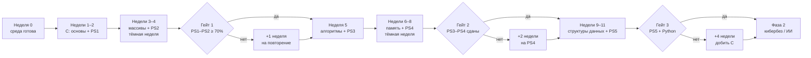
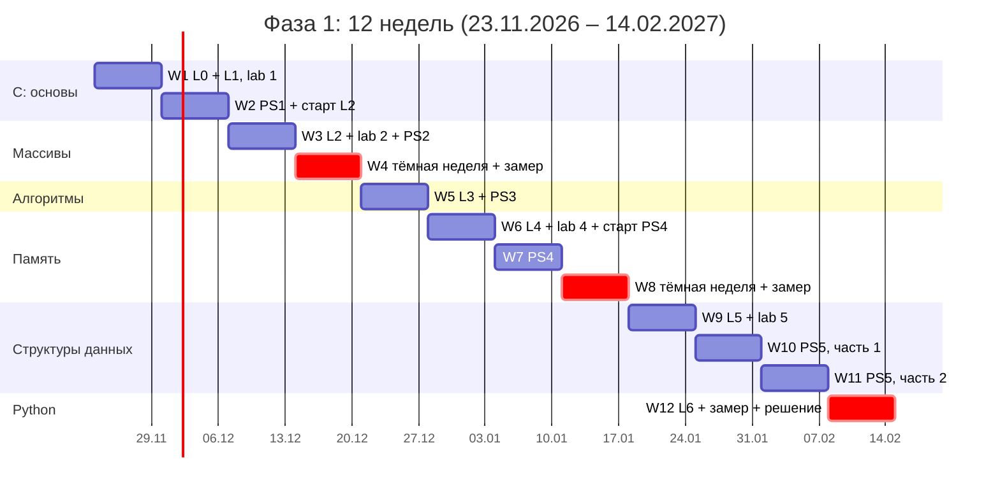

# Фундамент: первые 12 недель

Это рабочее расписание фазы 1. Общая карта на 6 фаз — [[plan/README]], первые дни —
[[plan/week-0-3]], английский — [[plan/english]], замеры — [[plan/tracker]].

Старт: **понедельник 23 ноября 2026**. Финиш 12-й недели: **14 февраля 2027**.
Режим: 5 дней в неделю по 60–90 мин, суббота — по желанию, воскресенье — выходной.

> **Честно о масштабе:** за 3 месяца CS50x целиком не проходят. Цель этих 12 недель —
> закрыть **C-половину** (лекции 0–5, задачи PS1–PS5) и войти в Python. Это ровно тот
> фундамент, без которого кибербез и ИИ превращаются в заучивание команд.

---

## 1. Где ты сейчас

| Параметр | Значение | Что это значит |
|---|---|---|
| Программирование | немного пробовал | не с нуля, но и не «уже умею» — стартуем с первой лекции, без перепрыгивания |
| Английский | A2–B1 | лекции CS50 понимаются на 40–60% — нормально, субтитры решают |
| Математика | школьная | для CS50 хватает; для ИИ догоним позже точечно |
| Время | 1–2 ч/день, 5 дней/нед | ~7–9 ч/нед. Это **медленнее** авторского темпа CS50, поэтому план растянут |
| Колледж | 6–8 ч/день | домашние слоты не отдаём колледжу (правило в [[plan/college-map]]) |
| Интересы | сети, серверы, кибербез, ИИ | значит C нужен не «для галочки», а как понимание памяти и сети |

**Главный риск не в сложности, а в темпе.** CS50 рассчитан на 8–12 ч/нед, у тебя 7–9.
Поэтому в плане 12 недель на 6 лекций, а не на 11. Это не отставание, это расчёт.

---

## 2. С чего начинать: CS50, CS101 или roadmap.sh

**Вердикт: CS50x — основной курс. CS101 — два вечера обзора, не курс. roadmap.sh —
карта раз в 4 недели, не учебная программа.**

### Критика по пунктам

| Ресурс | Сильные стороны | Слабые стороны | Роль у тебя |
|---|---|---|---|
| **CS50x** | практика с первого дня, авто-проверка `check50`/`style50`, объясняет память и указатели, бесплатно, дедлайн лета 2027 | стартует на C — тяжело; темп высокий; на 3–4 неделе многие бросают; лекции длинные (1.5–2 ч) | **основной курс**, но в 1.5–2 раза медленнее авторского темпа |
| **Stanford CS101** | лёгкий вход, общая картина (биты, железо, сети, немного Python), хороший английский | это курс для не-программистов: кода мало, автоматической проверки нет, материалы открыты не полностью и обновляются редко; после него ты всё равно не умеешь программировать | **2 вечера в начале**, чтобы появилась карта местности. Не тратить на него месяц |
| **roadmap.sh (Computer Science)** | показывает, что вообще существует: сети, ОС, БД, алгоритмы; удобно искать дырки | это не курс, а оглавление; много лишнего для джуна (дискретка, теория вычислений); провоцирует «учу галочки» | **самодиагностика 20 мин раз в 4 недели**, не более |

### Почему не «сначала roadmap, потом CS50»

Roadmap не даёт навыка. Три недели на раскрашивание галочек = ноль строк кода и
ложное чувство прогресса. Roadmap полезен, когда уже есть чем мерить: «умею ли я
объяснить, что такое DNS?» — да/нет. Пока мерить нечем, он только пугает объёмом.

### Почему не начинать с CS101 вместо CS50

CS101 отвечает на вопрос «из чего состоит компьютер». CS50 отвечает на вопрос
«как заставить компьютер что-то сделать». Тебе нужен второй ответ, а первый уже
есть в [[Основы/Как всё работает]]. Если после CS50 захочется системности — CS101
можно посмотреть фоном, по 1 лекции в дороге.

### Если C пойдёт тяжело

Правило: **не бросать раньше 3 недель.** «Тяжело» — это норма, указатели болят у всех.
Признак реальной проблемы не боль, а «я не понимаю и мне не интересно» **после**
третьей недели и сданного PS1. Тогда переключись на CS50P (Python) и вернись к C
на фазе 2. Это адаптация маршрута, а не провал.

---

## 3. Первый язык: C, Python или JavaScript

**Вердикт: C — учебный язык (через CS50), Python — рабочий, JavaScript — позже для веба.**

| Язык | Зачем он тебе | Когда | Где реально используется |
|---|---|---|---|
| **C** | понимание памяти, указателей, стека и кучи; без этого кибербез — набор команд | недели 1–10 | ядро Linux, драйверы, эксплойты, embedded |
| **Python** | автоматизация, скрипты, сети, безопасность, ИИ, бэкенд | с недели 11–12 и дальше | безопасность, ML, DevOps, бэкенд |
| **JavaScript** | читать и ломать веб-приложения (XSS, фронтенд) | фаза 2–3 | браузер, фронтенд, Node.js |

Почему так:

- **C не для резюме, а для мозга.** Джуном на C не нанимают (кроме embedded), но
  после CS50 ты понимаешь, что такое адрес, переполнение буфера и почему SQL-инъекция
  работает. Это твой «незаменимый угол» в безопасности.
- **Python первым — ловушка.** На нём легко писать, не понимая, что происходит.
  Через год ты не ответишь на вопрос «что такое указатель» и «почему программа упала
  по памяти». C закрывает этот пробел за 2 месяца.
- **JavaScript первым — худший вариант для тебя.** Он скрывает память, зато даёт
  асинхронность и браузерную магию; джунов на JS переизбыток; для безопасности и ИИ
  он вторичен. JS нужен, но как второй инструмент, а не как фундамент.
- **Про переезд.** США, Сербия, Италия — рынки разные, но Python + английский + Linux
  переносятся в любой из них. Страну выбирают на 12-м месяце, когда есть навык,
  а не на первом. Сейчас выбор языка ≠ выбор страны.

Итог: **не «C или Python», а «C, чтобы понять, Python, чтобы работать».**

---

## 4. Английский внутри кода

Английский не отдельный урок. Он встроен в то, что ты и так делаешь:

| Когда | Что делаешь | Сколько |
|---|---|---|
| Каждая лекция | смотришь с **английскими** субтитрами; непонятный кусок — 30 сек с русскими, потом пересматриваешь на английском | 0 доп. времени |
| Каждый день | Anki: 3–5 новых карточек из лекции (слово + фраза из контекста) | 5 мин |
| Каждый коммит | сообщение на английском; README к домашке — на английском | 0 доп. времени |
| Каждая пятница | голосовое на 3 мин: «что я сделал за неделю» | 3 мин |
| 2 раза в неделю | чат с ИИ: объясняешь свой код по-английски, просишь исправить ошибки | 15 мин |
| Каждый замер | 5 мин лекции **без субтитров**, оцениваешь % понимания | 5 мин раз в 4 недели |

Три правила, чтобы не утонуть:

1. **Не переводи всё.** Переводи только то, без чего не решается задача. Остальное —
   по смыслу. Технический английский — это 300–500 слов, которые покрывают 80% текста.
2. **Смотри на 1.0x, не на 1.5x.** На 1.5x ты тренируешь скорость, а не понимание.
3. **Говори вслух, даже один.** Раз в неделю объясняй вслух (можно себе в телефон)
   одну тему: «A pointer is a variable that stores a memory address». Это тот навык,
   который проверяют на собеседовании.

Подробный план — [[plan/english]].

---

## 5. График на 12 недель

### Маршрут и гейты

### Календарь

### Недели

| Неделя | Даты | Лекции | Практика | Результат недели |
|---|---|---|---|---|
| 1 | 23–29.11 | L0 (Scratch), L1 «C», часть 1 | lab 1, PS1: hello + mario | компилируешь и запускаешь C сам |
| 2 | 30.11–6.12 | L1, часть 2 + shorts | PS1: cash; L2 старт | PS1 сдан через `check50` |
| 3 | 7–13.12 | L2 «Arrays» | lab 2, PS2: readability + caesar | массивы и строки не пугают |
| 4 | 14–20.12 | — | только повторение и добивание PS2 | **Гейт 1** + замер |
| 5 | 21–27.12 | L3 «Algorithms» | PS3: plurality | объясняешь O(n) и бинарный поиск |
| 6 | 28.12–3.01 | L4 «Memory», часть 1 | lab 4, старт PS4 (filter) | понимаешь стек, кучу, `malloc` |
| 7 | 4–10.01 | L4, часть 2 | PS4 до конца | PS4 сдан |
| 8 | 11–17.01 | — | повторение, добить PS4 | **Гейт 2** + замер |
| 9 | 18–24.01 | L5 «Data Structures» | lab 5 | связный список и хеш-таблица руками |
| 10 | 25–31.01 | — | PS5 (speller), часть 1 | загружает словарь в память |
| 11 | 1–7.02 | — | PS5, часть 2 | PS5 сдан, `valgrind` чистый |
| 12 | 8–14.02 | L6 «Python» | 3 маленькие программы на Python | **Гейт 3** + замер + решение |

> Праздники (Новый год) попадают на недели 5–6. Это нормально: в эти две недели
> достаточно 20–40 мин в день и одной задачи. Не пытайся наверстать «долг» — его нет.

---

## 6. Первые 4 недели — по дням

### Неделя 1 (23–29 ноября): «программа — это инструкции»

| День     | Что делать                                                                                            | Побочно              |
| -------- | ----------------------------------------------------------------------------------------------------- | -------------------- |
| Пн 23.11 | CS50 Lecture 0 (Scratch) — только первые 40 мин. Выписать: алгоритм, цикл, условие, переменная        | Anki 5 мин           |
| Вт 24.11 | Lecture 1, часть 1: типы, `printf`, `cs50.h`, компиляция. Повторить за лектором `hello.c` и `agree.c` | Anki 5 мин           |
| Ср 25.11 | Lecture 1, часть 2: циклы, функции, область видимости. Своими руками — `mario.c` с одной пирамидкой   | 3 карточки из лекции |
| Чт 26.11 | Shorts недели 1 + lab 1. Настроить `check50` и `style50`, сдать лабораторную                          | —                    |
| Пт 27.11 | PS1: `hello` + `mario` (less). Сдать оба, посмотреть отчёт `check50`                                  | голосовое 3 мин      |
| Сб 28.11 | По желанию 1.5–2 ч: начать `cash` (less)                                                              | —                    |
| Вс 29.11 | **Отдых**                                                                                             | —                    |

**Считается сделанным, если:** `hello` и `mario` приняты `check50` (≥ 70%),
ты можешь без подсказок скомпилировать и запустить свою программу, 5 дней Anki.

### Неделя 2 (30 ноября – 6 декабря): «PS1 до конца»

| День | Что делать | Побочно |
|---|---|---|
| Пн 30.11 | Закончить `cash`; если `check50` < 70% — разобрать ошибки, а не переписывать наугад | Anki 5 мин |
| Вт 1.12 | `style50`: переписать `mario` с нуля без подсказок, 40 мин | Anki 5 мин |
| Ср 2.12 | Lecture 2 «Arrays», часть 1: массивы, строки, `argv` | Anki 5 мин |
| Чт 3.12 | Lecture 2, часть 2 + shorts. Своя программа: считает буквы в слове | 3 карточки |
| Пт 4.12 | Lab 2, сдать. Записать в конспект: чем массив отличается от переменной | голосовое 3 мин |
| Сб 5.12 | По желанию: начать PS2 `readability` | — |
| Вс 6.12 | **Отдых** | — |

**Считается сделанным, если:** PS1 полностью сдан, ты объясняешь, что такое индекс
массива и почему `argv[0]` — имя программы.

### Неделя 3 (7–13 декабря): «массивы и текст»

| День | Что делать | Побочно |
|---|---|---|
| Пн 7.12 | PS2 `readability`: формула Коулмана–Лиау, циклы по строке | Anki 5 мин |
| Вт 8.12 | Добить `readability`, сдать. Если < 70% — разбор ошибок | Anki 5 мин |
| Ср 9.12 | Shorts недели 2. Своя программа: переворачивает строку | Anki 5 мин |
| Чт 10.12 | Lab 2 (если не сдан) + `style50` по всем файлам | — |
| Пт 11.12 | PS2 `caesar`: сдвиг букв, проверка аргументов | голосовое 3 мин |
| Сб 12.12 | По желанию: закончить `caesar` | — |
| Вс 13.12 | **Отдых** | — |

**Считается сделанным, если:** `readability` сдан, `caesar` сдан или сделан на 80%.

### Неделя 4 (14–20 декабря): тёмная неделя

Никакого нового материала. Только повторение, английский и замер.

| День | Что делать |
|---|---|
| Пн 14.12 | Переписать `hello` и `mario` с нуля, 60 мин, без подсказок и без ИИ |
| Вт 15.12 | 20 мин английского + видео Computerphile про память (с субтитрами) |
| Ср 16.12 | Разобрать все ошибки `check50` за месяц, записать в «что не понял» |
| Чт 17.12 | Прочитать свой код вслух по-английски: что делает каждая строка |
| Пт 18.12 | **Замер уровня** по шаблону [[Шаблоны/Замер уровня]]: PS, коммиты, % понимания лекции без субтитров |
| Сб 19.12 | План на следующие 4 недели. Отдых |
| Вс 20.12 | **Отдых** |

- [ ] **Гейт 1:** PS1–PS2 сданы ≥ 70%, C не пугает 📅 2026-12-20

**Если PS2 не сдан** — не геройствуй: перенеси хвост на неделю 5 и сдвинь PS3
на неделю 6. Календарь сдвинется, ничего не сломается.

---

## 7. Критерии перехода

Не по ощущению «вроде понял», а по цифрам.

| Гейт | Когда | Объективные критерии | Если не выполнено |
|---|---|---|---|
| **Гейт 1** | конец недели 4 | PS1–PS2 сданы, `check50` ≥ 70%, `style50` ≥ 0.5; объясняешь значение vs адрес; 15 дней по 20 мин | < 40% — повтори недели 1–3 в темпе 2 недели на блок; 40–70% — добавь 1 неделю |
| **Гейт 2** | конец недели 8 | PS3–PS4 сданы; пишешь программу на 100–150 строк с нуля за 2 ч; объясняешь стек, кучу, `malloc`/`free`, O(n) | не сдан PS4 — +2 недели, не начинай PS5 на дыре |
| **Гейт 3** | конец недели 12 | PS5 сдан (или ≥ 70% correctness); 3 программы на Python; 60% лекции без субтитров; README на английском | < 40% — остаёшься на C ещё 4 недели; 40–70% — Python медленнее, по 1 программе в неделю |
| **Фаза 1 целиком** | ~неделя 18 | 8 из 10 PS ≥ 70%, 7 из 9 лекций Missing Semester, терминал и Git, 1–2 проекта | см. [[plan/README]] §Фаза 1 |

**Правило перехода:** двигаешься дальше, когда критерий выполнен **и** ты можешь
объяснить тему вслух простыми словами. Если объяснить не можешь — это не «знание»,
это узнавание.

**Чего не делать на гейтах:** не начинать параллельно новый курс, не смотреть
следующую лекцию «на всякий случай», не сравнивать себя с теми, кто прошёл CS50
за 3 недели.

---

## 8. Если что-то пошло не так

| Ситуация | Что делать |
|---|---|
| Отстал на неделю | Ничего не догоняй. Продолжай с текущего места, календарь сдвинется |
| C не идёт после 3 недель | CS50P (Python) на 4 недели, потом вернись к C на фазе 2 |
| Нет сил вечером | 20 мин: одна задача или 5 карточек. День засчитан |
| Пропустил 3+ дня | Неделя в режиме «только 20 минут», без нового материала |
| Скучно на лекции | Пропусти теорию, иди в задачу; читай ровно тот кусок, который нужен |
| Застрял на задаче > 2 ч | 20 мин сам → 20 мин документация → потом спроси ИИ «почему», а не «напиши» |
| Хочется бросить | Это неделя 3–4, классика. Сделай самое лёгкое задание из уже сданных |

---

## 9. Что сделать сегодня

1. Открой [[plan/setup]] и проверь, что VS Code, Python, Git и `check50` работают.
2. Открой [[plan/week-0-3]] и закрой оставшиеся пункты недели 0.
3. Заведи дневную заметку и поставь галочку «20 минут» — цепочка начинается сегодня.

---

## Связанные заметки

[[plan/README]] · [[plan/week-0-3]] · [[plan/english]] · [[plan/tracker]] ·
[[plan/resources]] · [[plan/college-map]] · [[Основы/Как всё работает]]
