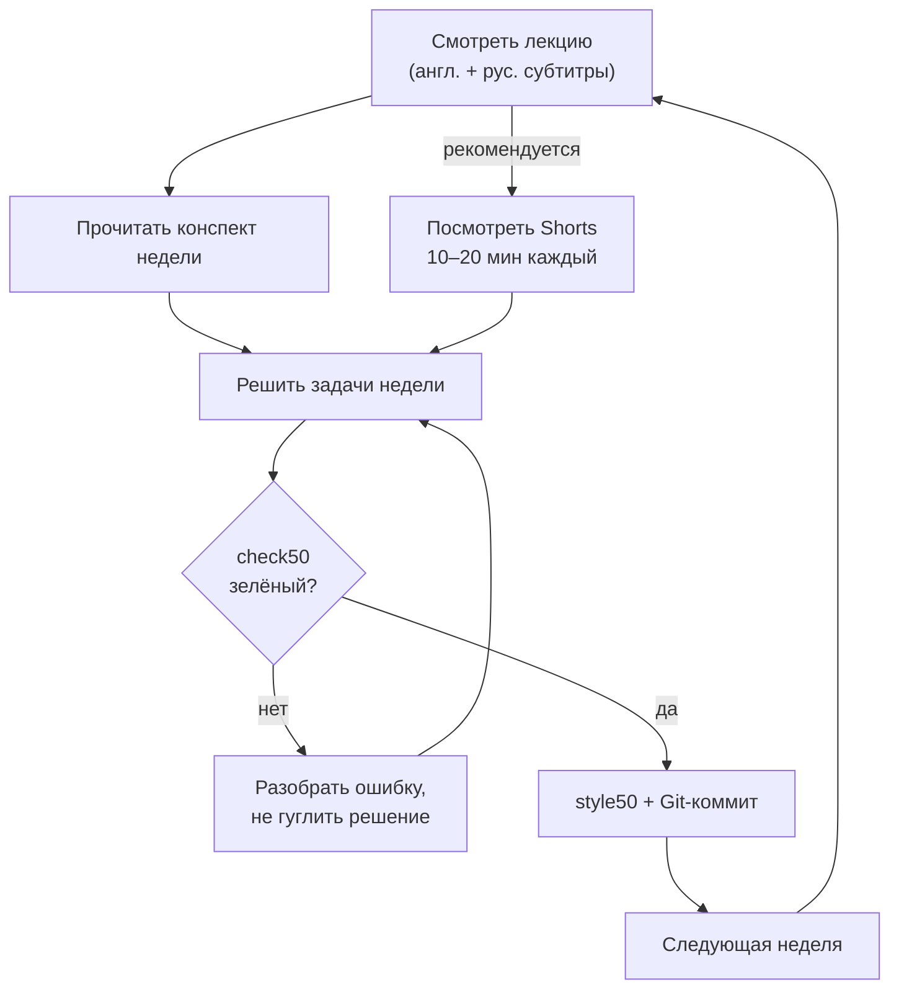

# CS50P — Introduction to Programming with Python

Русский конспект курса Гарварда **CS50P**: 10 недель, от `print("hello, world")` до классов, регулярок и финального проекта. Здесь весь смысл лекций, код с русскими комментариями, схемы и перевод условий задач. Лекции — по ссылкам на оригинал (полного дубляжа на русском нет, см. [ниже](#про-русский-перевод-лекций)).

> [!info] Это адаптация, а не официальный перевод
> Оригинал: [cs50.harvard.edu/python](https://cs50.harvard.edu/python/), автор — David J. Malan, Harvard University.
> Лицензия оригинала и этого конспекта: [CC BY-NC-SA 4.0](https://creativecommons.org/licenses/by-nc-sa/4.0/).
> Текст пересказан и сокращён, код перепечатан, схемы перерисованы заново на русском. Изменения внесены. Курс бесплатный и некоммерческий — конспект тоже.
> Точные формулировки заданий и автотесты — только в оригинале: конспект не заменяет `check50`.

---

## Как проходить курс

Правило курса: **одна неделя — один коммит в GitHub**. Папка `cs50p/` внутри твоего репозитория с задачами.

### Как сдавать задачи

| Шаг | Что делать |
|---|---|
| 1 | Зарегистрироваться: [форма CS50](https://forms.cs50.io/27a35e60-490a-4e42-8574-6b55154ae760) |
| 2 | Привязать GitHub: [submit.cs50.io](https://submit.cs50.io/invites/579861a2825849178cd11315c055bc49) → **Authorize CS50** → **Join course** |
| 3 | Открыть [cs50.dev](https://cs50.dev/) — облачный VS Code со всем готовым, ставить Python не надо |
| 4 | В терминале `update50`, затем `check50 cs50/problems/2022/python/<задача>` |
| 5 | Стиль: `style50 <файл>.py` |
| 6 | Сдача: `submit50 cs50/problems/2022/python/<задача>` |

Дедлайн курса: **30 июня 2027**. Дедлайны в CS50 мягкие, но сертификат выдаётся только за сданные в срок работы.

---

## Недели

| № | Тема | Лекция | Задачи |
|---|---|---|---|
| 0 | [[Курсы/CS50P/Неделя 0 — Функции и переменные\|Функции и переменные]] | [YouTube](https://youtu.be/JP7ITIXGpHk) · [конспект](https://cs50.harvard.edu/python/notes/0/) · [слайды](https://cdn.cs50.net/python/2022/x/lectures/0/lecture0.pdf) | [PSet 0](https://cs50.harvard.edu/python/psets/0/) — 5 шт. |
| 1 | [[Курсы/CS50P/Неделя 1 — Условия\|Условия]] | [YouTube](https://youtu.be/_b6NgY_pMdw) · [конспект](https://cs50.harvard.edu/python/notes/1/) · [слайды](https://cdn.cs50.net/python/2022/x/lectures/1/lecture1.pdf) | [PSet 1](https://cs50.harvard.edu/python/psets/1/) — 5 шт. |
| 2 | [[Курсы/CS50P/Неделя 2 — Циклы\|Циклы]] | [YouTube](https://youtu.be/-7xg8pGcP6w) · [конспект](https://cs50.harvard.edu/python/notes/2/) · [слайды](https://cdn.cs50.net/python/2022/x/lectures/2/lecture2.pdf) | [PSet 2](https://cs50.harvard.edu/python/psets/2/) — 5 шт. |
| 3 | [[Курсы/CS50P/Неделя 3 — Исключения\|Исключения]] | [YouTube](https://youtu.be/LW7g1169v7w) · [конспект](https://cs50.harvard.edu/python/notes/3/) · [слайды](https://cdn.cs50.net/python/2022/x/lectures/3/lecture3.pdf) | [PSet 3](https://cs50.harvard.edu/python/psets/3/) — 4 шт. |
| 4 | [[Курсы/CS50P/Неделя 4 — Библиотеки\|Библиотеки]] | [YouTube](https://youtu.be/MztLZWibctI) · [конспект](https://cs50.harvard.edu/python/notes/4/) · [слайды](https://cdn.cs50.net/python/2022/x/lectures/4/lecture4.pdf) | [PSet 4](https://cs50.harvard.edu/python/psets/4/) — 6 шт. |
| 5 | [[Курсы/CS50P/Неделя 5 — Юнит-тесты\|Юнит-тесты]] | [YouTube](https://youtu.be/tIrcxwLqzjQ) · [конспект](https://cs50.harvard.edu/python/notes/5/) · [слайды](https://cdn.cs50.net/python/2022/x/lectures/5/lecture5.pdf) | [PSet 5](https://cs50.harvard.edu/python/psets/5/) — 4 шт. |
| 6 | [[Курсы/CS50P/Неделя 6 — Файлы\|Файлы (File I/O)]] | [YouTube](https://youtu.be/KD-Yoel6EVQ) · [конспект](https://cs50.harvard.edu/python/notes/6/) · [слайды](https://cdn.cs50.net/python/2022/x/lectures/6/lecture6.pdf) | [PSet 6](https://cs50.harvard.edu/python/psets/6/) — 4 шт. |
| 7 | [[Курсы/CS50P/Неделя 7 — Регулярные выражения\|Регулярные выражения]] | [YouTube](https://youtu.be/hy3sd9MOAcc) · [конспект](https://cs50.harvard.edu/python/notes/7/) · [слайды](https://cdn.cs50.net/python/2022/x/lectures/7/lecture7.pdf) | [PSet 7](https://cs50.harvard.edu/python/psets/7/) — 5 шт. |
| 8 | [[Курсы/CS50P/Неделя 8 — ООП\|ООП: классы и объекты]] | [YouTube](https://youtu.be/e4fwY9ZsxPw) · [конспект](https://cs50.harvard.edu/python/notes/8/) · [слайды](https://cdn.cs50.net/python/2022/x/lectures/8/lecture8.pdf) | [PSet 8](https://cs50.harvard.edu/python/psets/8/) — 3 шт. |
| 9 | [[Курсы/CS50P/Неделя 9 — И прочее\|И прочее (Et Cetera)]] | [YouTube](https://youtu.be/6pgodt1mezg) · [конспект](https://cs50.harvard.edu/python/notes/9/) · [слайды](https://cdn.cs50.net/python/2022/x/lectures/9/lecture9.pdf) | — |
| — | [[Курсы/CS50P/Финальный проект\|Финальный проект]] | — | [проект](https://cs50.harvard.edu/python/project/) |

Дополнительно: [[Курсы/CS50P/Шортсы|все Shorts]] (короткие видео по отдельным темам) · [галерея финальных проектов](https://cs50.harvard.edu/python/gallery/).

---

## Про русский перевод лекций

Проверено в ноябре 2026: **полного перевода лекций CS50P на русский найти не удалось.** Есть только:

- официальные видео CS50 на английском (ссылки выше);
- автоперевод субтитров YouTube — он нормальный, но технические термины иногда врёт;
- любительские переводы *вводной* лекции, без продолжения.

Поэтому схема такая:

1. Включаешь на YouTube: **Настройки (шестерёнка) → Субтитры → Автоперевод → Русский**.
2. Смотришь 15–20 минут, дальше читаешь конспект недели — он на русском и короче лекции в 10 раз.
3. Непонятный фрагмент — перематываешь и слушаешь на английском с англ. субтитрами. Для [[plan/english|английского]] это полезнее, чем дубляж.

> [!warning] Термины из автоперевода
> «Строка» может стать «линией», «return» — «возвратом», `float` — «плавать». Если фраза в субтитрах бессмысленна — смотри английский оригинал, а не русский автоперевод.

---

## Как читать конспект

| Что в конспекте | Что с оригиналом |
|---|---|
| Текст лекции | Пересказ на русском, без воды, с сохранением логики и примеров |
| Код | Перепечатан, комментарии переведены, добавлены пояснения |
| Схемы и картинки | **Перерисованы заново в Mermaid** с русскими подписями. Скриншоты кода заменены кодом — так их можно копировать и запускать |
| Условия задач | Сжатый перевод: что дано, что вернуть, какие крайние случаи. Точные строки вывода и тесты — в оригинале |
| Термины | В каждой неделе таблица «английский → русский», чтобы не терять связь с лекцией |

Почему не перевод картинок «как есть»: пиксельный текст в Obsidian не читается на телефоне, не редактируется и не копируется. Схема в Mermaid масштабируется, перекрашивается темой и правится за минуту. Для учёбы это строго лучше.

---

## Связь с планом

CS50P в [[plan/fundament-3-months|плане фазы 1]] — запасной маршрут: если C идёт тяжело, переключаешься на Python на 4 недели и возвращаешься. Курс также закрывает Python-часть CS50x и даёт базу для [[Проекты/Идеи простыми словами|проекта на лето 2027]].

Реалистичный темп при 1–2 ч/день: **1 неделя курса = 1–2 недели календаря**. Не гонись за автором: он читает лекцию на 2 часа, тебе на неё нужно 2–3 дня по 40 минут.

---

## Прогресс

| Неделя | Лекция | Конспект | Задачи сданы | Коммит |
|---|---|---|---|---|
| 0 | [ ] | [ ] | [ ] | [ ] |
| 1 | [ ] | [ ] | [ ] | [ ] |
| 2 | [ ] | [ ] | [ ] | [ ] |
| 3 | [ ] | [ ] | [ ] | [ ] |
| 4 | [ ] | [ ] | [ ] | [ ] |
| 5 | [ ] | [ ] | [ ] | [ ] |
| 6 | [ ] | [ ] | [ ] | [ ] |
| 7 | [ ] | [ ] | [ ] | [ ] |
| 8 | [ ] | [ ] | [ ] | [ ] |
| 9 | [ ] | [ ] | — | [ ] |
| Проект | — | [ ] | [ ] | [ ] |

Замеры уровня — раз в 4 недели в `Журнал/Замеры/`, см. [[plan/tracker]].
