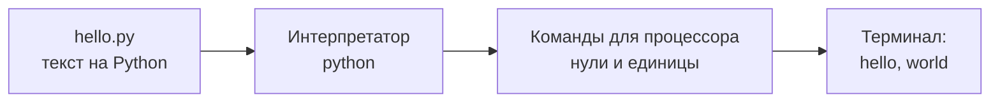
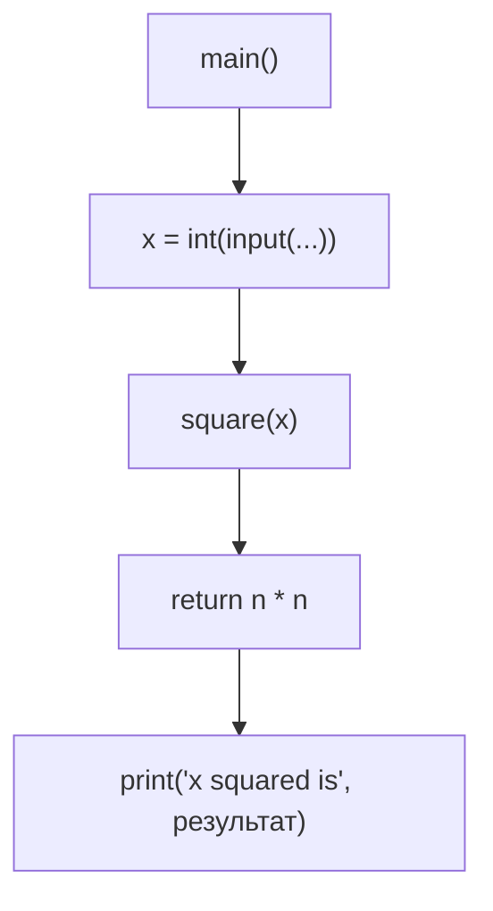

# Неделя 0. Функции и переменные

> **Лекция:** [YouTube](https://youtu.be/JP7ITIXGpHk) · [видеоплеер CS50](https://video.cs50.io/JP7ITIXGpHk) · [MP3](https://cdn.cs50.net/python/2022/x/lectures/0/lecture0.mp3)
> **Текст:** [notes](https://cs50.harvard.edu/python/notes/0/) · [слайды PDF](https://cdn.cs50.net/python/2022/x/lectures/0/lecture0.pdf) · [код с лекции](https://cdn.cs50.net/python/2022/x/lectures/0/src0.zip) · [транскрипт](https://cdn.cs50.net/python/2022/x/lectures/0/lang/en/lecture0.txt)
> **Задачи:** [Problem Set 0](https://cs50.harvard.edu/python/psets/0/)
> Назад: [[Курсы/CS50P/README|оглавление курса]]

## Что нужно понять к концу недели

- программа — это текст, который интерпретатор превращает в команды для процессора;
- функция = действие; аргумент = то, что в неё передали; побочный эффект = то, что она сделала с миром;
- переменная — имя для значения, `=` — присваивание, а не «равно»;
- строка `str` — последовательность текста, у неё есть методы (`.strip()`, `.title()`);
- `int` и `float` — числа, ввод пользователя всегда приходит строкой, его надо приводить;
- своя функция: `def`, параметры, `return`, `main()`;
- код должен читаться человеком, а не только запускаться.

---

## 1. Первая программа

В терминале:

```bash
code hello.py      # создать файл
python hello.py    # запустить
```

```python
print("hello, world")
```

Компьютер понимает только нули и единицы. `python hello.py` — это команда «возьми текст из `hello.py`, разбери его и выполни». Переводом занимается **интерпретатор** (в CS50 это CPython).



## 2. Функции, аргументы, побочные эффекты

`print` — встроенная функция. `"hello, world"` — её **аргумент**. Всё, что она печатает в терминал, — **побочный эффект** (side effect): функция изменила мир вокруг себя, но ничего не вернула.

Три слова, которые надо различать:

| Термин | Что это | Пример |
|---|---|---|
| Функция | действие, у которого есть имя | `print`, `input`, `round` |
| Аргумент / параметр | значение, которое передаём | `"hello"` в `print("hello")` |
| Возвращаемое значение | результат, который функция отдаёт обратно | `input()` возвращает строку |

## 3. Баги — норма

```python
print("hello, world"
```

`SyntaxError: '(' was never closed` — забыли `)`. Ошибка не позор, а подсказка: интерпретатор говорит, где сломалось. Читаем сообщение **снизу вверх**: последняя строка — суть, выше — где именно.

## 4. Переменные и ввод

```python
name = input("What's your name? ")
print("hello,")
print(name)
```

`=` — это присваивание: справа вычисляется значение, слева получает имя. `input("...")` печатает приглашение и возвращает **строку**.

Ошибка новичка:

```python
print("hello, name")   # напечатает слово name, а не значение переменной
```

Кавычки делают из имени текст. Без кавычек — переменная.

## 5. Комментарии и псевдокод

```python
# Спросить имя
name = input("What's your name? ")

# Поздороваться
print(f"hello, {name}")
```

**Псевдокод** — комментарии-шаги, когда ещё не знаешь, как писать код. Сначала план словами, потом перевод в Python. Это не детский приём: так пишут и взрослые.

## 6. Строки

```python
name = input("What's your name? ").strip().title()
print(f"hello, {name}")
```

- `.strip()` — убирает пробелы и переводы строк по краям;
- `.title()` — каждое слово с большой буквы;
- методы можно вызывать цепочкой: `strip().title()`;
- `f"..."` — f-string, подставляет значение переменной прямо в текст: `f"hello, {name}"`.

Кавычки внутри строки:

```python
print("hello, \"friend\"")   # экранирование
print('hello, "friend"')     # или другие кавычки снаружи
```

`print` по умолчанию ставит перевод строки в конце. Его можно отключить:

```python
print("hello,", end="")
print(name)          # hello, David — в одной строке
```

Здесь `end` — **именованный аргумент** (параметр со значением по умолчанию `"\n"`).

## 7. Числа: int

```python
x = input("What's x? ")   # "1"
y = input("What's y? ")   # "2"
print(x + y)              # "12" — это склейка строк!
```

Ввод — всегда `str`. Нужно привести тип:

```python
x = int(input("What's x? "))
y = int(input("What's y? "))
print(x + y)              # 3
```

`int(...)` — **приведение типа** (casting). Функции можно вкладывать: сначала выполняется внутренняя (`input`), потом внешняя (`int`).

Операторы: `+`, `-`, `*`, `/`, `%` (остаток от деления), `**` (степень).

```python
print(7 % 2)   # 1 — остаток
print(2 ** 10) # 1024
```

## 8. Float и форматирование

```python
x = float(input("What's x? "))
y = float(input("What's y? "))
z = x / y
print(z)              # 0.6666666666666666
print(round(z, 2))    # 0.67
print(f"{z:.2f}")     # 0.67 — то же через f-string
```

`round(число, знаков)` — округление. `f"{z:.2f}"` — ровно два знака после точки.

Разделители тысяч:

```python
print(f"{1000:,}")    # 1,000
```

> [!tip] Почему `0.1 + 0.2` не равно `0.3`
> `float` хранится в двоичном виде с конечной точностью, поэтому часть дробей непредставима точно. Для денег используют `decimal` или целые копейки. В CS50P это всплывёт в задачах про проценты.

## 9. Свои функции

```python
def hello(to):
    print("hello,", to)

name = input("What's your name? ")
hello(name)
```

- `def` — объявление функции;
- `to` — **параметр**, `name` при вызове — **аргумент**;
- тело функции выделяется **отступом** (4 пробела). Отступ в Python — часть синтаксиса, а не украшение.

Значение по умолчанию:

```python
def hello(to="world"):
    print("hello,", to)

hello()        # hello, world
hello("Dave")  # hello, Dave
```

## 10. main и return

```python
def main():
    name = input("What's your name? ")
    hello(name)

def hello(to="world"):
    print("hello,", to)

main()
```

Без последней строки `main()` программа «молчит»: функции объявлены, но никто их не вызвал. `main()` — просто соглашение, Python не требует именно такого имени, но так читают код все.

Функция может **вернуть** значение вместо печати:

```python
def main():
    x = int(input("What's x? "))
    print("x squared is", square(x))

def square(n):
    return n * n

main()
```

`return` отдаёт результат в место вызова. `print` показывает текст, `return` — передаёт данные дальше. Путать их — самая частая ошибка первых недель.



## 11. Читаемость

Один и тот же код можно написать десятью способами. Выбирай тот, который понятен через месяц:

- имена переменных — существительные (`name`, `total`), функции — глаголы (`get_name`, `calculate`);
- не вкладывай пять вызовов в одну строку без нужды;
- комментарий объясняет **зачем**, а не «что» (`# спрашиваем имя`, а не `# вызываем input`);
- пустая строка между логическими блоками.

## Термины

| Английский | Русский | Смысл |
|---|---|---|
| function | функция | действие с именем |
| argument / parameter | аргумент / параметр | что передали / что принимает |
| side effect | побочный эффект | изменение мира (печать, запись файла) |
| return value | возвращаемое значение | результат функции |
| bug | баг, ошибка | дефект в коде |
| pseudocode | псевдокод | план словами |
| casting | приведение типа | `int("5")` |
| f-string | форматированная строка | `f"привет, {name}"` |
| scope | область видимости | где переменная видна |

## Задачи недели (перевод условий)

> Точные требования и тесты — в [оригинале](https://cs50.harvard.edu/python/psets/0/). Ниже суть каждой задачи.

| Задача | Что нужно сделать | Ссылка |
|---|---|---|
| **Indoor Voice** | Спросить текст и вывести его строчными буквами, «как в помещении» — без крика | [indoor](https://cs50.harvard.edu/python/psets/0/indoor/) |
| **Playback Speed** | Заменить каждый пробел на `...` (как в медленном воспроизведении) | [playback](https://cs50.harvard.edu/python/psets/0/playback/) |
| **Making Faces** | Заменить `:)` на 🙂 и `:(` на 🙁 в введённой строке | [faces](https://cs50.harvard.edu/python/psets/0/faces/) |
| **Einstein** | По массе `m` посчитать `E = mc²`, `c = 300000000` м/с, вывести целое число джоулей | [einstein](https://cs50.harvard.edu/python/psets/0/einstein/) |
| **Tip Calculator** | Счёт, процент чаевых, число людей → сумма с каждого, ровно 2 знака после точки, с `$` | [tip](https://cs50.harvard.edu/python/psets/0/tip/) |

Подсказки по инструментам, а не по решениям:

- `"ПРИВЕТ".lower()` → `"привет"`;
- `"a b".replace(" ", "...")` → `"a...b"`;
- `f"{sum:.2f}"` → два знака после точки;
- `int(...)` для Эйнштейна: результат должен быть целым.

## Чек-лист недели

- [ ] Запустил `hello.py` и `calculator.py` у себя, а не только посмотрел
- [ ] Понимаю разницу между `print` и `return`
- [ ] Могу объяснить, почему `input()` возвращает `str` и что делает `int()`
- [ ] Написал свою функцию с параметром и значением по умолчанию
- [ ] Все 5 задач проходят `check50`
- [ ] `style50` не ругается
- [ ] Сделал коммит `week0: functions, variables`

Дальше: [[Курсы/CS50P/Неделя 1 — Условия]]
