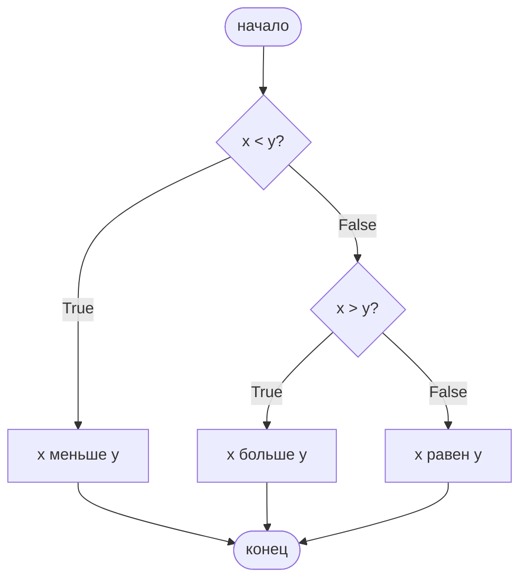

# Неделя 1. Условия

> **Лекция:** [YouTube](https://youtu.be/_b6NgY_pMdw) · [видеоплеер](https://video.cs50.io/_b6NgY_pMdw) · [MP3](https://cdn.cs50.net/python/2022/x/lectures/1/lecture1.mp3)
> **Текст:** [notes](https://cs50.harvard.edu/python/notes/1/) · [слайды PDF](https://cdn.cs50.net/python/2022/x/lectures/1/lecture1.pdf) · [код](https://cdn.cs50.net/python/2022/x/lectures/1/src1.zip)
> **Задачи:** [Problem Set 1](https://cs50.harvard.edu/python/psets/1/)
> Назад: [[Курсы/CS50P/README|оглавление]] · Предыдущая: [[Курсы/CS50P/Неделя 0 — Функции и переменные|Неделя 0]]

## Что нужно понять к концу недели

- `if` выполняет блок, только если условие истинно;
- `elif` и `else` — это «иначе если» и «иначе», они исключают лишние проверки;
- `==` сравнивает, `=` присваивает — разные вещи;
- `and`, `or`, `not` собирают сложные условия;
- `%` (остаток) решает задачи «делится ли», «чётное ли»;
- `match` — чистый способ выбрать одну ветку из многих.

---

## 1. Операторы сравнения

```python
x = int(input("What's x? "))
y = int(input("What's y? "))

if x < y:
    print("x меньше y")
```

| Оператор | Значение |
|---|---|
| `<`, `>` | меньше, больше |
| `<=`, `>=` | меньше/больше или равно |
| `==` | равно (сравнение) |
| `!=` | не равно |

`x < y` — выражение, у которого есть значение `True` или `False` (тип `bool`). `if` просто смотрит на это значение.

## 2. Три отдельных if — плохо

```python
if x < y:
    print("x меньше y")
if x > y:
    print("x больше y")
if x == y:
    print("x равен y")
```

Работает, но задаёт три вопроса, когда хватило бы двух: если `x < y`, остальные проверки заведомо ложны.

```python
if x < y:
    print("x меньше y")
elif x > y:
    print("x больше y")
else:
    print("x равен y")
```

`elif` проверяется, только если предыдущее условие было ложным. `else` — если все предыдущие ложны. Это и есть **control flow** — поток управления.



## 3. and, or, not

```python
name = input("What's your name? ")

if name in ("Harry", "Hermione", "Ron"):
    print("Gryffindor")
elif name in ("Draco",):
    print("Slytherin")
else:
    print("Who?")
```

```python
if name == "Harry" or name == "Hermione" or name == "Ron":
    print("Gryffindor")
```

Оба варианта верны; второй длиннее, но показывает суть `or`. `name in (...)` — короткая и читаемая запись «одно из».

- `and` — истинно, только если истинны **оба**;
- `or` — истинно, если истинно **хотя бы одно**;
- `not` — инвертирует: `not True` → `False`.

Python вычисляет лениво: в `a and b` при ложном `a` второй не проверяется. На этом строится защита от ошибок: `if y != 0 and x / y > 2:`.

## 4. Логические ошибки

Код может работать без `SyntaxError` и всё равно быть неверным:

```python
if x > 0 or x < 10:      # всегда True: любое число подходит
    print("подходит")
```

Правильно — `and`. Такие ошибки не ловит интерпретатор, их ловят тесты и голова.

## 5. Оценки: elif на практике

```python
score = int(input("Score: "))

if score >= 90:
    print("Grade: A")
elif score >= 80:
    print("Grade: B")
elif score >= 70:
    print("Grade: C")
elif score >= 60:
    print("Grade: D")
else:
    print("Grade: F")
```

Порядок важен: проверки идут сверху вниз, и первая сработавшая забирает результат. Если поставить `>= 60` первым, все получат D.

## 6. Modulo — остаток от деления

```python
print(10 % 3)   # 1
print(4 % 2)    # 0
```

`x % 2 == 0` — признак чётности. Это половина всех задач первых недель.

```python
x = int(input("What's x? "))

if x % 2 == 0:
    print("Even")
else:
    print("Odd")
```

## 7. Своя функция-предикат

```python
def main():
    x = int(input("What's x? "))
    if is_even(x):
        print("Even")
    else:
        print("Odd")

def is_even(n):
    if n % 2 == 0:
        return True
    else:
        return False

main()
```

Это уже лучше: логика отделена от ввода-вывода, функцию можно протестировать (неделя 5).

## 8. Pythonic

```python
def is_even(n):
    return n % 2 == 0
```

Сравнение само по себе даёт `bool`, поэтому `if ... return True else return False` — лишний код. «Питонично» — значит коротко и без повторов, но не в ущерб чтению.

Ещё пример:

```python
if 90 <= score <= 100:    # цепочка сравнений, как в математике
    print("A")
```

## 9. match

Когда вариантов много и они не пересекаются, `match` читается лучше лестницы `elif`:

```python
name = input("What's your name? ")

match name:
    case "Harry" | "Hermione" | "Ron":
        print("Gryffindor")
    case "Draco":
        print("Slytherin")
    case _:
        print("Who?")
```

- `case ... | ...` — несколько вариантов в одной ветке;
- `case _:` — «всё остальное», аналог `else`;
- `match` появился в Python 3.10. Если в задаче нужен python 3.8, используй `elif`.

> [!note] Ловушка `match`
> `match` — не «switch с проваливанием». Совпадение ровно одно, `break` не нужен. И это не регулярное выражение, хотя слово знакомое.

## Термины

| Английский | Русский | Смысл |
|---|---|---|
| conditional | условие | `if`/`elif`/`else` |
| boolean expression | логическое выражение | выражение со значением `True`/`False` |
| control flow | поток управления | порядок выполнения веток |
| modulo | остаток от деления | `%` |
| parity | чётность | чётное/нечётное |
| predicate | предикат | функция, возвращающая `bool` |
| pythonic | питоничный | идиоматичный для Python код |

## Задачи недели (перевод условий)

> Точные требования — в [оригинале](https://cs50.harvard.edu/python/psets/1/).

| Задача | Что нужно сделать | Ссылка |
|---|---|---|
| **Deep Thought** | Ответ на «Great Question»: `42`, `forty-two`, `forty two` → `Yes`, иначе `No` | [deep](https://cs50.harvard.edu/python/psets/1/deep/) |
| **Home Federal Savings Bank** | Приветствие начинается с `hello` → `$0`; с `h` → `$20`; иначе `$100`. Без учёта регистра и пробелов | [bank](https://cs50.harvard.edu/python/psets/1/bank/) |
| **File Extensions** | По имени файла вернуть MIME-тип: `gif`, `jpg`, `jpeg`, `png`, `pdf`, `txt`, `zip`, иначе `application/octet-stream`. Регистр не важен | [extensions](https://cs50.harvard.edu/python/psets/1/extensions/) |
| **Math Interpreter** | Выражение вида `1 + 2` (целые и `+ - * /`) → результат. Деление — float с одним знаком | [interpreter](https://cs50.harvard.edu/python/psets/1/interpreter/) |
| **Meal Time** | Время `7:30` → `breakfast time` (7:00–8:00), `lunch time` (12:00–13:00), `dinner time` (18:00–19:00) | [meal](https://cs50.harvard.edu/python/psets/1/meal/) |

Что пригодится:

- `s.lower()`, `s.startswith("hello")`, `s.strip()`;
- `filename.endswith(".gif")` — но помни про регистр: `"cat.GIF".lower()`;
- `"1 + 2".split(" ")` → `["1", "+", "2"]`;
- `h, m = input().split(":")` — распаковка на лету.

## Чек-лист недели

- [ ] Объясню, чем `=` отличается от `==`
- [ ] Понимаю, почему три `if` подряд хуже `elif`
- [ ] Проверил на своих числах, что `or` не заменяет `and`
- [ ] Написал `is_even` в одну строку и понимаю, почему так можно
- [ ] Все 5 задач сданы, `check50` зелёный
- [ ] Коммит `week1: conditionals`

Дальше: [[Курсы/CS50P/Неделя 2 — Циклы]]
