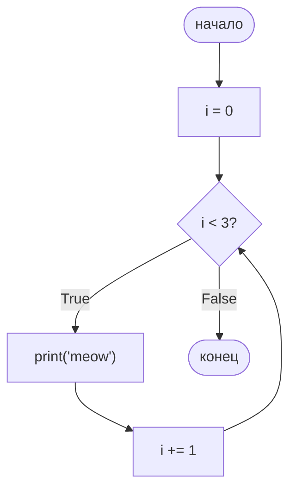
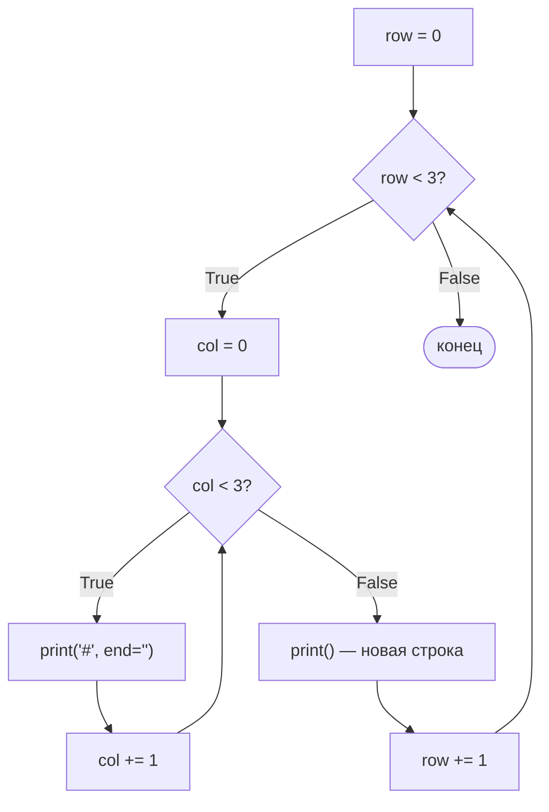

# Неделя 2. Циклы

> **Лекция:** [YouTube](https://youtu.be/-7xg8pGcP6w) · [видеоплеер](https://video.cs50.io/-7xg8pGcP6w) · [MP3](https://cdn.cs50.net/python/2022/x/lectures/2/lecture2.mp3)
> **Текст:** [notes](https://cs50.harvard.edu/python/notes/2/) · [слайды PDF](https://cdn.cs50.net/python/2022/x/lectures/2/lecture2.pdf) · [код](https://cdn.cs50.net/python/2022/x/lectures/2/src2.zip)
> **Задачи:** [Problem Set 2](https://cs50.harvard.edu/python/psets/2/)
> Назад: [[Курсы/CS50P/README|оглавление]] · Предыдущая: [[Курсы/CS50P/Неделя 1 — Условия|Неделя 1]]

## Что нужно понять к концу недели

- `while` повторяет, пока условие истинно; легко получить вечный цикл;
- `for` проходит по готовой последовательности и не требует счётчика;
- `range(n)` — от `0` до `n-1`, `range(a, b)` — от `a` до `b-1`;
- список `list` хранит много значений по порядку, словарь `dict` — по ключу;
- `len()` — длина; перебор списка — `for x in list`;
- вложенные циклы печатают таблицы и фигуры (Mario).

---

## 1. while

```python
i = 0
while i < 3:
    print("meow")
    i += 1
```

Разбор:

1. `i = 0` — начальное состояние;
2. `i < 3` — проверка **перед** каждой итерацией;
3. тело: печать и увеличение счётчика;
4. как только `i` станет `3`, условие ложно, цикл заканчивается.



Забыл `i += 1` — программа печатает `meow` бесконечно. Остановить: `Ctrl+C`.

## 2. for и range

```python
for i in range(3):
    print("meow")
```

`range(3)` даёт `0, 1, 2`. Переменная `i` внутри не нужна — тогда по соглашению пишут `_`:

```python
for _ in range(3):
    print("meow")
```

| Запись | Что даёт |
|---|---|
| `range(3)` | `0, 1, 2` |
| `range(1, 4)` | `1, 2, 3` |
| `range(2, 11, 2)` | `2, 4, 6, 8, 10` |
| `range(3, 0, -1)` | `3, 2, 1` |

В Python **нет** `do ... while`. Его эмулируют через `while True` + `break`.

## 3. Ввод, который не принимают

Задача: спросить число, пока не введут положительное.

```python
while True:
    n = int(input("What's n? "))
    if n > 0:
        break
```

- `while True` — «крутись, пока не выйдут изнутри»;
- `break` — немедленный выход из **ближайшего** цикла;
- `continue` — перейти к следующей итерации, не выполняя остаток тела.

Тот же смысл без `while True`:

```python
n = int(input("What's n? "))
while n <= 0:
    n = int(input("What's n? "))
```

Дублирование `input` — цена за «без бесконечного цикла». Оба варианта правильные; выбирай тот, что читается.

> [!warning] `int(input(...))` падает на пустом вводе и на буквах
> `ValueError: invalid literal for int()`. Это лечится `try/except` — неделя 3. Пока считаем, что пользователь вводит числа.

## 4. Списки

```python
students = ["Hermione", "Harry", "Ron"]

for student in students:
    print(student)
```

Список — упорядоченная коллекция. Доступ по индексу с нуля:

```python
print(students[0])   # Hermione
print(students[-1])  # Ron — последний
```

Добавить в конец — `.append()`:

```python
students.append("Draco")
```

Сравни с циклом по индексам — он нужен, когда важна позиция:

```python
for i in range(len(students)):
    print(i + 1, students[i])
```

`len(students)` — количество элементов. `range(len(...))` — частая связка, хотя в Python чаще перебирают значения напрямую.

## 5. Словари

```python
students = {
    "Hermione": "Gryffindor",
    "Harry": "Gryffindor",
    "Ron": "Gryffindor",
    "Draco": "Slytherin",
}

print(students["Hermione"])   # Gryffindor
```

Словарь хранит пары **ключ → значение**. Ключи уникальны, порядок вставки сохраняется, поиск быстрый.

Перебор:

```python
for student in students:
    print(student, students[student], sep=", ")
```

`for` по словарю даёт **ключи**, а не значения. Значение — `students[key]`.

Значение по умолчанию — `.get()`, чтобы не падать на отсутствующем ключе:

```python
print(students.get("Luna"))          # None
print(students.get("Luna", "Unknown"))  # Unknown
```

> [!tip] Список или словарь?
> Нужен порядок и повторы — список. Нужен поиск по имени/ключу — словарь. Список словарей — обычная структура «таблица»: `students = [{"name": "Harry", "house": "Gryffindor"}, ...]`.

## 6. Mario: вложенные циклы

Сначала самое простое — умножение строк:

```python
print("#" * 3)     # ###
```

Потом цикл по строкам:

```python
for i in range(3):
    print("#" * (i + 1))
```

```
#
##
###
```

Обратная лесенка с пробелами:

```python
n = 3
for i in range(n):
    print(" " * (n - i - 1) + "#" * (i + 1))
```

```
  #
 ##
###
```

Вложенный цикл — когда на каждой строке печатается несколько разных символов:

```python
for row in range(3):
    for col in range(3):
        print("#", end="")
    print()          # перевод строки после ряда
```



Внешний цикл отвечает за строки, внутренний — за символы в строке. Пустой `print()` после внутреннего цикла обязателен, иначе всё слипнется в одну строку.

## Термины

| Английский | Русский | Смысл |
|---|---|---|
| loop | цикл | повторение блока |
| iteration | итерация | один проход тела цикла |
| infinite loop | вечный цикл | условие никогда не станет ложным |
| list | список | упорядоченная коллекция |
| dictionary | словарь | пары ключ → значение |
| index | индекс | номер элемента с нуля |
| nested loops | вложенные циклы | цикл внутри цикла |

## Задачи недели (перевод условий)

> Точные требования — в [оригинале](https://cs50.harvard.edu/python/psets/2/).

| Задача | Что нужно сделать | Ссылка |
|---|---|---|
| **camelCase** | Перевести имя в camelCase в snake_case: `firstName` → `first_name` | [camel](https://cs50.harvard.edu/python/psets/2/camel/) |
| **Coke Machine** | Автомат: монеты 25/10/5, цена 50. Показывать `Amount Due: N`, после оплаты — `Change Owed: N` | [coke](https://cs50.harvard.edu/python/psets/2/coke/) |
| **Just setting up my twttr** | Убрать из строки все гласные (`a e i o u`, в любом регистре) | [twttr](https://cs50.harvard.edu/python/psets/2/twttr/) |
| **Vanity Plates** | Проверить номер: 2 буквы в начале, до 6 символов, цифры только в конце, первая цифра не 0, без `.,;:!?` | [plates](https://cs50.harvard.edu/python/psets/2/plates/) |
| **Nutrition Facts** | Фрукт → калории по таблице из задания; неизвестный фрукт игнорировать | [nutrition](https://cs50.harvard.edu/python/psets/2/nutrition/) |

Что пригодится:

- `s.isupper()`, `s.islower()`, `s.isalpha()`, `s.isdigit()` — проверки символов;
- `for ch in s:` — перебор строки по символам;
- `s.replace("a", "")` — не решает twttr целиком, но полезно;
- словарь «фрукт → калории» — самое прямое решение nutrition.

> [!note] Про Vanity Plates
> Это первая задача, где нужен аккуратный набор условий. Не пиши 20 вложенных `if`. Сначала выпиши правила словами на бумаге, потом каждое — отдельной проверкой с `and`/`or`. И проверь на примерах из задания: `CS50`, `CS05`, `PI3.14`, `OUTATIME`.

## Чек-лист недели

- [ ] Написал `meow` тремя способами: `while`, `for range`, `print("meow\n" * 3, end="")`
- [ ] Знаю, что делает `break` и `continue`
- [ ] Перебрал список и словарь без подглядывания
- [ ] Сделал лесенку Mario в обе стороны
- [ ] Все 5 задач сданы
- [ ] Коммит `week2: loops, lists, dicts`

Дальше: [[Курсы/CS50P/Неделя 3 — Исключения]]
