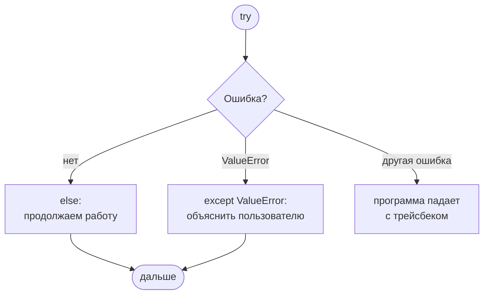

# Неделя 3. Исключения

> **Лекция:** [YouTube](https://youtu.be/LW7g1169v7w) · [видеоплеер](https://video.cs50.io/LW7g1169v7w) · [MP3](https://cdn.cs50.net/python/2022/x/lectures/3/lecture3.mp3)
> **Текст:** [notes](https://cs50.harvard.edu/python/notes/3/) · [слайды PDF](https://cdn.cs50.net/python/2022/x/lectures/3/lecture3.pdf) · [код](https://cdn.cs50.net/python/2022/x/lectures/3/src3.zip)
> **Задачи:** [Problem Set 3](https://cs50.harvard.edu/python/psets/3/)
> Shorts: [Debugging](https://cs50.harvard.edu/python/shorts/debugging/) · [Handling Exceptions](https://cs50.harvard.edu/python/shorts/handling_exceptions/) · [Raising Exceptions](https://cs50.harvard.edu/python/shorts/raising_exceptions/)
> Назад: [[Курсы/CS50P/README|оглавление]] · Предыдущая: [[Курсы/CS50P/Неделя 2 — Циклы|Неделя 2]]

## Что нужно понять к концу недели

- ошибка выполнения (runtime error) — не баг синтаксиса, а ситуация, которую программа не предусмотрела;
- `try` пробует, `except` ловит конкретный тип ошибки;
- `else` выполняется, если ошибки не было;
- `raise` создаёт свою ошибку, `sys.exit()` завершает программу с сообщением;
- `pass` — заглушка «ничего не делать»;
- правильно обработанная ошибка не прячет баг, а объясняет пользователю, что не так.

---

## 1. Ошибки времени выполнения

```python
x = int(input("What's x? "))
print(f"x is {x}")
```

Если ввести `cat`:

```
ValueError: invalid literal for int() with base 10: 'cat'
```

`ValueError` — тип исключения. Другие частые:

| Исключение | Когда |
|---|---|
| `ValueError` | значение не подходит: `int("cat")` |
| `TypeError` | несовместимые типы: `"2" + 2` |
| `NameError` | переменная не объявлена |
| `ZeroDivisionError` | деление на ноль |
| `IndexError` | индекс за пределами списка |
| `KeyError` | нет такого ключа в словаре |
| `FileNotFoundError` | файла нет |

## 2. try / except

```python
try:
    x = int(input("What's x? "))
except ValueError:
    print("x is not an integer")
```

- код в `try` выполняется как обычно;
- если внутри возникло **именно** `ValueError`, управление уходит в `except`;
- остальные ошибки не ловятся — и это хорошо: не маскируем чужие баги.



Голый `except:` ловит **всё**, включая `Ctrl+C` и опечатки в собственном коде. Так почти никогда не надо. Лови конкретный тип.

## 3. else

```python
try:
    x = int(input("What's x? "))
except ValueError:
    print("x is not an integer")
else:
    print(f"x is {x}")
```

`else` — «если ошибки не случилось». Смысл: в `try` держим только рискованную строку, а всё остальное — в `else`. Так видно, что именно защищено.

## 4. Цикл «спрашивай, пока не введут число»

```python
while True:
    try:
        x = int(input("What's x? "))
    except ValueError:
        print("x is not an integer")
    else:
        break

print(f"x is {x}")
```

`break` стоит в `else`, а не в `try`: иначе он выполнится и при ошибке (если поставить после `except` внутри цикла — логика сломается).

## 5. Своя функция get_int

```python
def main():
    x = get_int("What's x? ")
    print(f"x is {x}")

def get_int(prompt):
    while True:
        try:
            return int(input(prompt))
        except ValueError:
            pass

main()
```

Три улучшения по сравнению с первым вариантом:

1. ввод спрятан в функцию — `main` читается как план;
2. `prompt` — параметр, функцию можно переиспользовать;
3. `return` прямо в `try`: как только ввод корректный, функция выходит.

`pass` здесь значит «ничего не делать, просто спросить снова». Без него `except` не может быть пустым — Python требует тело.

Тот же `get_int` с сообщением об ошибке:

```python
def get_int(prompt):
    while True:
        try:
            return int(input(prompt))
        except ValueError:
            print("Not an integer, try again")
```

## 6. raise — создать ошибку самому

```python
def get_positive_int(prompt):
    while True:
        try:
            n = int(input(prompt))
        except ValueError:
            print("Not an integer")
            continue
        if n > 0:
            return n
        print("Must be positive")
```

А можно короче — «выбросить» ошибку и поймать её там же:

```python
def get_positive_int(prompt):
    while True:
        try:
            n = int(input(prompt))
            if n <= 0:
                raise ValueError("must be positive")
        except ValueError:
            print("Invalid input")
        else:
            return n
```

`raise ValueError("...")` — сигнал «здесь неправильные данные». Встроенные функции делают так же: `int("cat")` внутри себя бросает `ValueError`.

Своё исключение — это класс (подробно на неделе 8):

```python
class OutOfRangeError(Exception):
    pass
```

## 7. sys.exit — выйти с сообщением

Когда продолжать бессмысленно, программу завершают:

```python
import sys

if len(sys.argv) != 2:
    sys.exit("Usage: python script.py <file>")

print(f"Processing {sys.argv[1]}")
```

`sys.exit("текст")` печатает текст в stderr и завершает процесс с ненулевым кодом. В задачах CS50 это стандартный способ сказать «неверный ввод» одной строкой.

> [!warning] `sys.exit` vs `return`
> `return` выходит из функции, `sys.exit` — из всей программы. Внутри `main()` иногда хочется `return`, но задания часто требуют именно сообщение и код выхода.

## 8. Отладка

- читай трейсбек **снизу вверх**: последняя строка — тип и текст, выше — файл и строка;
- ставь `print(...)` в подозрительное место и смотри, доходит ли туда выполнение;
- в VS Code — точка останова (клик слева от номера строки) и запуск в режиме Debug: программа остановится, и можно смотреть значения переменных;
- проверяй крайние случаи: пустой ввод, ноль, отрицательное, очень большое число, буквы.

Shorts [Debugging](https://cs50.harvard.edu/python/shorts/debugging/) показывает это на живом примере — 15 минут, которые экономят часы.

## Термины

| Английский | Русский | Смысл |
|---|---|---|
| exception | исключение | объект-ошибка |
| runtime error | ошибка выполнения | возникает при запуске, не при разборе кода |
| try / except | попытка / перехват | защищённый блок и обработчик |
| raise | выбросить исключение | создать ошибку вручную |
| traceback | трейсбек | стек вызовов на момент ошибки |
| handling | обработка | что программа делает с ошибкой |

## Задачи недели (перевод условий)

> Точные требования — в [оригинале](https://cs50.harvard.edu/python/psets/3/).

| Задача | Что нужно сделать | Ссылка |
|---|---|---|
| **Fuel Gauge** | Дробь `X/Y` → процент `Z%`, 1% и меньше → `E`, 99% и больше → `F`. Неверный ввод (не число, `X > Y`, `Y = 0`) → спросить снова; в `convert` такие случаи → `ValueError` | [fuel](https://cs50.harvard.edu/python/psets/3/fuel/) |
| **Felipe's Taqueria** | Меню словарём, сумма заказа по позициям, вывод `$итог` с 2 знаками | [taqueria](https://cs50.harvard.edu/python/psets/3/taqueria/) |
| **Grocery List** | Список покупок построчно → количество каждого товара, `N ТОВАР` заглавными, отсортировано по алфавиту | [grocery](https://cs50.harvard.edu/python/psets/3/grocery/) |
| **Outdated** | Даты `9/8/1636` или `September 8, 1636` → `1636-09-08`. Неверный формат → спросить снова | [outdated](https://cs50.harvard.edu/python/psets/3/outdated/) |

Что пригодится:

- `x, y = input("Fraction: ").split("/")` — распаковка;
- `round(x / y * 100)` — процент;
- `dict[key]` падает с `KeyError`, `dict.get(key, 0)` — нет;
- `datetime.date(year, month, day)` проверяет существование даты;
- `sys.exit("Invalid date")` — для неверного ввода;
- словарь месяцев: `{"January": 1, ...}` или `list(calendar.month_name)`.

## Чек-лист недели

- [ ] Отличаю `SyntaxError` (код не разобрался) от `ValueError` (данные плохие)
- [ ] Объясню, зачем `else` после `try`, если есть `break`
- [ ] Ловлю конкретное исключение, а не `except:`
- [ ] Написал `get_int` с `raise` и без
- [ ] Все 4 задачи сданы
- [ ] Коммит `week3: exceptions`

Дальше: [[Курсы/CS50P/Неделя 4 — Библиотеки]]
