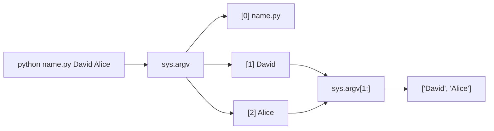

# Неделя 4. Библиотеки

> **Лекция:** [YouTube](https://youtu.be/MztLZWibctI) · [видеоплеер](https://video.cs50.io/MztLZWibctI) · [MP3](https://cdn.cs50.net/python/2022/x/lectures/4/lecture4.mp3)
> **Текст:** [notes](https://cs50.harvard.edu/python/notes/4/) · [слайды PDF](https://cdn.cs50.net/python/2022/x/lectures/4/lecture4.pdf) · [код](https://cdn.cs50.net/python/2022/x/lectures/4/src4.zip)
> **Задачи:** [Problem Set 4](https://cs50.harvard.edu/python/psets/4/)
> Shorts: [Random](https://cs50.harvard.edu/python/shorts/random/) · [API Calls](https://cs50.harvard.edu/python/shorts/api_calls/) · [Creating Modules and Packages](https://cs50.harvard.edu/python/shorts/creating_modules_packages/) · [Style](https://cs50.harvard.edu/python/shorts/style/)
> Назад: [[Курсы/CS50P/README|оглавление]] · Предыдущая: [[Курсы/CS50P/Неделя 3 — Исключения|Неделя 3]]

## Что нужно понять к концу недели

- `import` подключает чужой код, `from ... import ...` — конкретные имена;
- стандартная библиотека Python огромна: `random`, `statistics`, `sys`, `datetime`;
- `sys.argv` — аргументы командной строки, `sys.argv[1:]` — все, кроме имени скрипта;
- `pip install` ставит сторонние пакеты с PyPI;
- API — это чужие функции по HTTP, ответ обычно в JSON;
- свой модуль — это просто файл `.py` рядом.

---

## 1. import

```python
import random

coin = random.choice(["heads", "tails"])
print(coin)
```

```python
from random import choice

coin = choice(["heads", "tails"])
```

| Способ | Плюс | Минус |
|---|---|---|
| `import random` + `random.choice` | видно, откуда функция | длиннее |
| `from random import choice` | короче | непонятно, чья функция |
| `import random as rnd` | короткий псевдоним | читаемость падает |

Правило: импортируй модуль целиком, если используешь много функций из него; одну функцию — можно и `from`.

`random`:

```python
import random

print(random.randint(1, 10))          # целое от 1 до 10 включительно
print(random.choice(["a", "b"]))      # случайный элемент
cards = ["jack", "queen", "king"]
random.shuffle(cards)                 # перемешать на месте
print(cards)                          # список изменён!
```

> [!warning] `random` — не для паролей и не для криптографии
> Это псевдослучайные числа с предсказуемым seed. Для безопасности — модуль `secrets`.

## 2. statistics

```python
import statistics

print(statistics.mean([100, 90]))     # 95
print(statistics.median([1, 3, 5]))   # 3
```

Не пиши среднее вручную ради учёбы — но знать, что `mean` есть, полезно.

## 3. sys.argv — аргументы командной строки

```python
import sys

print("hello, my name is", sys.argv[1])
```

```bash
python name.py David      # hello, my name is David
python name.py            # IndexError: list index out of range
```

`sys.argv` — список строк: `[0]` — имя скрипта, дальше — то, что напечатали после него.

Проверка количества аргументов:

```python
import sys

if len(sys.argv) < 2:
    sys.exit("Too few arguments")
elif len(sys.argv) > 2:
    sys.exit("Too many arguments")

print("hello, my name is", sys.argv[1])
```

Срез — все аргументы, кроме первого:

```python
for name in sys.argv[1:]:
    print("hello,", name)
```



Срезы работают не только с argv:

```python
s = "Harvard"
print(s[0:3])    # Har
print(s[:3])     # Har
print(s[3:])     # vard
print(s[-1])     # d
print(s[::-1])   # dravraH — реверс
```

## 4. Пакеты и pip

Стандартная библиотека — не всё. Сторонние пакеты лежат на [PyPI](https://pypi.org/).

```bash
pip install cowsay
```

```python
import cowsay

cowsay.cow("This is CS50")
```

```
  ________________
< This is CS50 >
  ----------------
        \   ^__^
         \  (oo)\_______
            (__)\       )\/\
                ||----w |
                ||     ||
```

Правила гигиены:

- ставь пакеты в виртуальное окружение (`python -m venv .venv`), а не в систему;
- фиксируй зависимости в `requirements.txt` — по одной на строку;
- `pip install -r requirements.txt` — воспроизвести окружение;
- не ставь пакет, если хватает стандартной библиотеки.

Имена пакетов и модулей иногда различаются: `pip install Pillow`, а `import PIL`.

## 5. API и requests

API — способ спросить данные у чужого сервера по HTTP. Ответ часто JSON — тот же словарь/список, только пришёл текстом.

```python
import requests

response = requests.get("https://api.github.com/users/dmalan")
data = response.json()

print(data["name"])
print(data["public_repos"])
```

- `requests.get(url)` отправляет GET-запрос;
- `response.json()` разбирает JSON в Python-объекты;
- `response.status_code` — 200 значит «ок», 404 — «нет такого»;
- API часто требуют ключ (`Authorization` header) или лимит запросов.

> [!note] Сеть может упасть
> В реальном коде `requests` оборачивают в `try/except requests.RequestException` и проверяют `status_code`. В задачах CS50 сеть доступна, но полагаться на «всегда ответит» — плохая привычка.

## 6. Свой модуль

`sayings.py`:

```python
def hello(name):
    print(f"hello, {name}")

def goodbye(name):
    print(f"goodbye, {name}")
```

`say.py` в той же папке:

```python
import sayings

sayings.hello("David")
```

Или:

```python
from sayings import hello

hello("David")
```

При импорте Python выполняет файл целиком. Поэтому «демонстрационный» вызов в модуле прячут за проверкой:

```python
def main():
    hello("world")

if __name__ == "__main__":
    main()
```

`__name__` равен `"__main__"` только когда файл запущен напрямую. При `import` он равен имени модуля, и `main()` не вызывается. Это стандартный приём, он понадобится в финальном проекте.

Пакет — папка с модулями и файлом `__init__.py`. Для CS50P достаточно модулей; пакеты — на будущее.

## Термины

| Английский | Русский | Смысл |
|---|---|---|
| library / module | библиотека / модуль | переиспользуемый код |
| package | пакет | набор модулей, ставится через pip |
| CLI arguments | аргументы командной строки | `sys.argv` |
| slice | срез | `s[a:b]` |
| API | программный интерфейс | чужие функции по сети |
| JSON | формат данных | пары ключ-значение и списки |
| dependency | зависимость | пакет, нужный программе |

## Задачи недели (перевод условий)

> Точные требования — в [оригинале](https://cs50.harvard.edu/python/psets/4/).

| Задача | Что нужно сделать | Ссылка |
|---|---|---|
| **Emojize** | Заменить `:alias:` на эмодзи через библиотеку `emoji`, `language="alias"` | [emojize](https://cs50.harvard.edu/python/psets/4/emojize/) |
| **Frank, Ian and Glen's Letters** | Вывести текст шрифтом FIGlet: `sys.argv` + `pyfiglet`, случайный шрифт, если `-f` не задан | [figlet](https://cs50.harvard.edu/python/psets/4/figlet/) |
| **Adieu, Adieu** | Имена до конца ввода (`Ctrl+D`) → `Adieu, adieu, to X`, `X and Y`, `X, Y, and Z` | [adieu](https://cs50.harvard.edu/python/psets/4/adieu/) |
| **Guessing Game** | Загадать 1–100, читать догадки: `Too small`, `Too large`, `Just right` | [game](https://cs50.harvard.edu/python/psets/4/game/) |
| **Little Professor** | Уровень 1–3, 10 примеров на сложение, 3 попытки на каждый, `EEE` при ошибке, в конце `Score: N` | [professor](https://cs50.harvard.edu/python/psets/4/professor/) |
| **Bitcoin Price Index** | Курс биткоина через API (CoinDesk), аргумент — количество BTC, вывод `$N,NNN.NNNN` | [bitcoin](https://cs50.harvard.edu/python/psets/4/bitcoin/) |

Что пригодится:

- `input()` в цикле бросает `EOFError` на `Ctrl+D` — это и есть «конец ввода»;
- `random.randint(a, b)` включает обе границы;
- `sys.argv` проверяй на длину **до** обращения к `[1]`;
- `except requests.RequestException` — сеть;
- `f"{price:,.4f}"` — тысячи через запятую и 4 знака.

## Чек-лист недели

- [ ] Запустил `name.py` с аргументом и без — увидел разницу
- [ ] Понимаю `sys.argv[1:]`
- [ ] Поставил хотя бы один пакет через `pip` и импортировал его
- [ ] Сделал запрос к публичному API и достал поле из JSON
- [ ] Понимаю, зачем `if __name__ == "__main__":`
- [ ] Все 6 задач сданы
- [ ] Коммит `week4: libraries, api`

Дальше: [[Курсы/CS50P/Неделя 5 — Юнит-тесты]]
