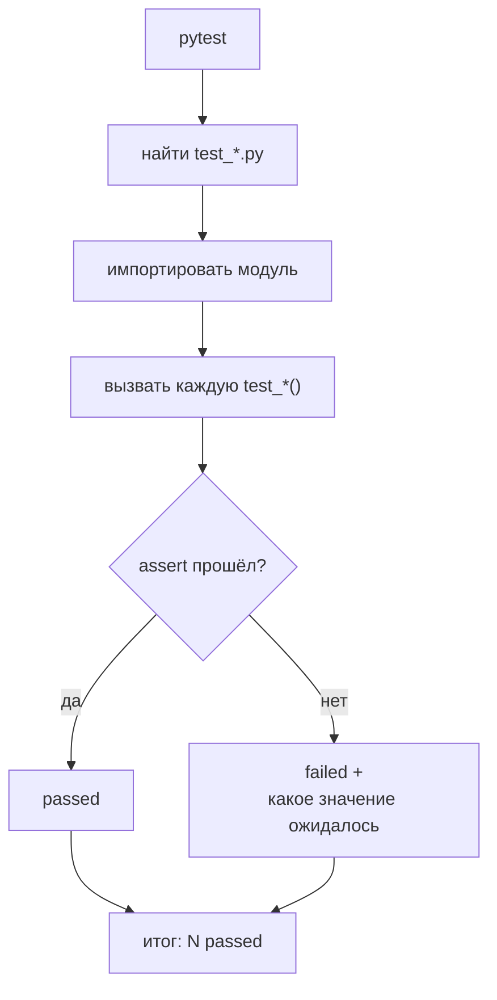

# Неделя 5. Юнит-тесты

> **Лекция:** [YouTube](https://youtu.be/tIrcxwLqzjQ) · [видеоплеер](https://video.cs50.io/tIrcxwLqzjQ) · [MP3](https://cdn.cs50.net/python/2022/x/lectures/5/lecture5.mp3)
> **Текст:** [notes](https://cs50.harvard.edu/python/notes/5/) · [слайды PDF](https://cdn.cs50.net/python/2022/x/lectures/5/lecture5.pdf) · [код](https://cdn.cs50.net/python/2022/x/lectures/5/src5.zip)
> **Задачи:** [Problem Set 5](https://cs50.harvard.edu/python/psets/5/)
> Shorts: [pytest](https://cs50.harvard.edu/python/shorts/pytest/)
> Назад: [[Курсы/CS50P/README|оглавление]] · Предыдущая: [[Курсы/CS50P/Неделя 4 — Библиотеки|Неделя 4]]

## Что нужно понять к концу недели

- тест — это код, который проверяет код;
- `assert условие` падает, если условие ложно;
- `pytest` сам находит файлы `test_*.py` и функции `test_*`;
- тестируют **чистые функции** (вход → выход), а не `input`/`print`;
- тест на ошибку пишется через `pytest.raises`;
- тесты — это документация поведения и страховка при рефакторинге.

---

## 1. Зачем тесты

Ручная проверка:

```python
from calculator import square

def main():
    test_square()

def test_square():
    if square(2) != 4:
        print("2 squared was not 4")
    if square(3) != 9:
        print("3 squared was not 9")

main()
```

Работает, но: сообщения надо придумывать, легко забыть случай, а `print` не останавливает проверку.

## 2. assert

```python
def test_square():
    assert square(2) == 4
    assert square(3) == 9
```

`assert` проверяет условие и, если оно ложно, выбрасывает `AssertionError`. Программа падает — и это правильное поведение: тест нашёл баг.

```python
def main():
    test_square()

def test_square():
    try:
        assert square(2) == 4
    except AssertionError:
        print("2 squared was not 4")
    ...
```

Так можно, но `pytest` делает это красивее и не требует `try` на каждый assert.

## 3. pytest

`calculator.py`:

```python
def square(n):
    return n * n
```

`test_calculator.py`:

```python
from calculator import square

def test_positive():
    assert square(2) == 4
    assert square(3) == 9

def test_negative():
    assert square(-2) == 4
    assert square(-3) == 9

def test_zero():
    assert square(0) == 0
```

Запуск:

```bash
pytest test_calculator.py
```

```
test_calculator.py ...                                    [100%]
3 passed in 0.01s
```

Правила, которые ищет pytest:

| Что | Шаблон |
|---|---|
| Файл | `test_*.py` или `*_test.py` |
| Функция | `test_*` |
| Класс (опционально) | `Test*` |

`main()` не нужен: pytest сам импортирует файл и вызывает тестовые функции.



Разделение на `test_positive`, `test_negative`, `test_zero` — не формальность. Если все проверки в одной функции, падение первой скрывает остальные. Отдельные функции показывают **все** проблемы сразу.

## 4. Тестирование строк

```python
from twttr import shorten

def test_lowercase():
    assert shorten("twitter") == "twttr"

def test_uppercase():
    assert shorten("TWITTER") == "twttr"

def test_numbers():
    assert shorten("CS50") == "CS50"

def test_punctuation():
    assert shorten("What's up?") == "Wht's p?"
```

Проверяй не только «нормальный» случай, но и:

- пустую строку;
- верхний регистр;
- цифры и знаки (их не трогаем);
- строку целиком из гласных.

## 5. Тесты в папке

Структура:

```
project/
├── calculator.py
└── test/
    └── test_calculator.py
```

```bash
pytest test
```

Папка `test/` держит тесты отдельно от кода. В задаче PSet 5 требуются именно такие имена и расположение — проверь требования в оригинале.

## 6. Тестирование исключений

Функция, которая должна падать:

```python
def test_negative():
    with pytest.raises(ValueError):
        square("cat")
```

`pytest.raises` — контекстный менеджер: тест проходит, только если внутри блока возникло указанное исключение. Можно проверить и сообщение:

```python
with pytest.raises(ValueError, match="invalid literal"):
    int("cat")
```

## 7. Что тестировать

| Тестируем | Не тестируем |
|---|---|
| чистые функции: вход → выход | `print` и `input` напрямую |
| границы: 0, 1, максимум | весь сценарий «пользователь кликает» |
| ошибки и исключения | сторонние библиотеки |

Поэтому код и разделяют на `main()` (ввод-вывод) и функции (логика). Если функция печатает вместо `return`, её почти невозможно протестировать — это главный практический урок недели.

> [!tip] TDD на минималках
> Сначала тест на желаемое поведение — потом код, пока тест не станет зелёным. Не догма, но хорошо отрезвляет: ты пишешь ровно то, что нужно, и сразу знаешь, что оно работает.

## Термины

| Английский | Русский | Смысл |
|---|---|---|
| unit test | юнит-тест | проверка одной функции |
| assert | утверждение | «это должно быть истинно» |
| test case | тест-кейс | конкретная проверка |
| fixture | фикстура | подготовка данных для теста |
| coverage | покрытие | доля кода, проверенная тестами |
| regression | регрессия | поломка того, что работало |

## Задачи недели (перевод условий)

> Точные требования — в [оригинале](https://cs50.harvard.edu/python/psets/5/). Здесь нужно **не решать заново**, а написать тесты к своим прошлым задачам.

| Задача | Что тестировать | Ссылка |
|---|---|---|
| **Testing my twttr** | `shorten` из недели 2: регистр, цифры, пунктуация, пустая строка | [test_twttr](https://cs50.harvard.edu/python/psets/5/test_twttr/) |
| **Back to the Bank** | `value` из задачи bank: `hello`, `h...`, прочее, регистр | [test_bank](https://cs50.harvard.edu/python/psets/5/test_bank/) |
| **Re-requesting a Vanity Plate** | `is_valid` из plates: длина, цифры, позиции, знаки | [test_plates](https://cs50.harvard.edu/python/psets/5/test_plates/) |
| **Refueling** | `convert` и `gauge` из fuel: дроби, `E`, `F`, ошибки | [test_fuel](https://cs50.harvard.edu/python/psets/5/test_fuel/) |

Важно: в этих задачах проверяют **твои** тесты (`check50` подсовывает сломанные версии функций и смотрит, поймал ли ты баг). Тест, который всегда проходит, — бесполезен.

## Чек-лист недели

- [ ] Понимаю, почему `print`-проверки хуже `assert`
- [ ] Запустил `pytest` и увидел `N passed`
- [ ] Сделал отдельные тесты на positive / negative / zero
- [ ] Написал тест, который **падает**, если функцию сломать вручную
- [ ] Проверил исключение через `pytest.raises`
- [ ] Все 4 задачи сданы
- [ ] Коммит `week5: unit tests`

Дальше: [[Курсы/CS50P/Неделя 6 — Файлы]]
