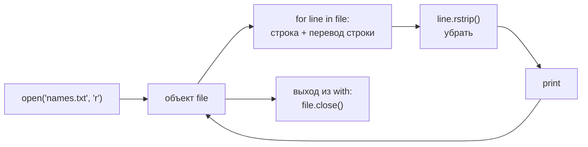

# Неделя 6. Файлы (File I/O)

> **Лекция:** [YouTube](https://youtu.be/KD-Yoel6EVQ) · [видеоплеер](https://video.cs50.io/KD-Yoel6EVQ) · [MP3](https://cdn.cs50.net/python/2022/x/lectures/6/lecture6.mp3)
> **Текст:** [notes](https://cs50.harvard.edu/python/notes/6/) · [слайды PDF](https://cdn.cs50.net/python/2022/x/lectures/6/lecture6.pdf) · [код](https://cdn.cs50.net/python/2022/x/lectures/6/src6.zip)
> **Задачи:** [Problem Set 6](https://cs50.harvard.edu/python/psets/6/)
> Shorts: [Reading and Writing Files](https://cs50.harvard.edu/python/shorts/reading_writing_files/) · [Reading and Writing CSVs](https://cs50.harvard.edu/python/shorts/reading_and_writing_csvs/) · [Pillow](https://cs50.harvard.edu/python/shorts/pillow/)
> Назад: [[Курсы/CS50P/README|оглавление]] · Предыдущая: [[Курсы/CS50P/Неделя 5 — Юнит-тесты|Неделя 5]]

## Что нужно понять к концу недели

- `open(путь, режим)` открывает файл: `"r"`, `"w"`, `"a"`;
- `with` закрывает файл сам, даже при ошибке;
- `.read()`, `.readlines()`, перебор файла построчно;
- `"w"` **уничтожает** старое содержимое, `"a"` дописывает;
- CSV — таблица в текстовом файле, работать через модуль `csv`;
- картинки — бинарные файлы, для них есть Pillow.

---

## 1. open и with

```python
with open("names.txt", "r") as file:
    for line in file:
        print(line.rstrip())
```

| Режим | Что делает |
|---|---|
| `"r"` | читать (файл должен существовать) |
| `"w"` | писать, **обрезая файл до нуля** |
| `"a"` | дописывать в конец |
| `"x"` | создать, упасть, если уже есть |

`with` — контекстный менеджер. Файл закрывается автоматически на выходе из блока, даже если внутри было исключение. Без `with` придётся писать `file.close()` и надеяться, что до него дойдёт выполнение.



## 2. Чтение

```python
with open("names.txt") as file:
    for line in file:
        print("hello,", line.rstrip())
```

Строка из файла приходит **с `\n` в конце**. `rstrip()` убирает пробелы и перевод строки справа. `strip()` — с обеих сторон.

Прочитать всё сразу:

```python
with open("names.txt") as file:
    lines = file.readlines()      # список строк, с \n
```

Добавить в список и отсортировать:

```python
names = []
with open("names.txt") as file:
    for line in file:
        names.append(line.rstrip())

for name in sorted(names):
    print(f"hello, {name}")
```

## 3. Запись

```python
name = input("What's your name? ")

with open("names.txt", "a") as file:
    file.write(f"{name}\n")
```

`write` **не добавляет** перевод строки. Забыл `\n` — все имена склеятся в одну строку.

Перезаписать файл:

```python
with open("names.txt", "w") as file:
    file.write("Alice\n")
```

> [!warning] `"w"` — необратимо
> Открытие с `"w"` очищает файл ещё до первой записи. Упадёт программа — данные уже потеряны. Для добавления — только `"a"`.

## 4. Кодировка

```python
with open("names.txt", encoding="utf-8") as file:
    ...
```

По умолчанию Python берёт кодировку системы. На Windows это может быть не UTF-8, и русский текст превратится в кракозябры или `UnicodeDecodeError`. **Всегда указывай `encoding="utf-8"`**, если в файле может быть не латиница.

## 5. CSV

`students.csv`:

```
name,house
Harry,Gryffindor
Draco,Slytherin
```

Чтение через списки:

```python
import csv

with open("students.csv") as file:
    reader = csv.reader(file)
    for row in reader:
        print(f"{row[0]} is in {row[1]}")
```

`row[0]`, `row[1]` — хрупко: стоит поменять порядок колонок, и всё сломается. Лучше по именам:

```python
import csv

with open("students.csv") as file:
    reader = csv.DictReader(file)
    for row in reader:
        print(f"{row['name']} is in {row['house']}")
```

Запись:

```python
import csv

with open("students.csv", "a", newline="") as file:
    writer = csv.DictWriter(file, fieldnames=["name", "house"])
    writer.writerow({"name": "Ron", "house": "Gryffindor"})
```

`newline=""` обязателен: без него на Windows появятся пустые строки между записями. `fieldnames` задаёт и порядок колонок, и заголовок (если файл новый — `writer.writeheader()`).

## 6. Бинарные файлы и Pillow

Картинка — не текст. Читать её как строку нельзя.

```python
from PIL import Image, ImageOps

before = Image.open("bridge.bmp")
after = ImageOps.grayscale(before)
after.save("bridge_gray.bmp")
```

```python
from PIL import Image

shirt = Image.open("shirt.png")
photo = Image.open("photo.jpg").resize(shirt.size)
photo.paste(shirt, (0, 0), shirt)     # третий аргумент — маска прозрачности
photo.save("out.png")
```

Основное:

| Функция | Что делает |
|---|---|
| `Image.open(path)` | открыть картинку |
| `.size` | `(ширина, высота)` |
| `.resize((w, h))` | изменить размер |
| `.paste(other, box, mask)` | наложить с прозрачностью |
| `.save(path)` | сохранить (формат по расширению) |
| `ImageOps.grayscale(img)` | в оттенки серого |

> [!tip] `pip install Pillow`, а `import PIL`
> Пакет и модуль называются по-разному. Это норма для Python, смотри имя импорта в документации.

## 7. Файлы и тесты

Функции, которые читают файлы, тестировать сложнее: нужен файл на диске. Приёмы:

- держи логику разбора отдельно от `open`: `parse(line)` тестируется без файлов;
- для тестов создавай временный файл через `tmp_path` в pytest;
- не полагайся на файлы в репозитории, если задача разрешает их не сдавать.

## Термины

| Английский | Русский | Смысл |
|---|---|---|
| file I/O | ввод-вывод файлов | чтение и запись |
| mode | режим | `r`, `w`, `a`, `x` |
| context manager | контекстный менеджер | `with`, закрывает ресурс |
| newline | перевод строки | `\n` |
| CSV | таблица с разделителем | comma-separated values |
| header | строка заголовков | первая строка CSV |
| encoding | кодировка | UTF-8, CP1251 |

## Задачи недели (перевод условий)

> Точные требования — в [оригинале](https://cs50.harvard.edu/python/psets/6/).

| Задача | Что нужно сделать | Ссылка |
|---|---|---|
| **Lines of Code** | Посчитать строки кода в `.py`-файле: без пустых и без строк-комментариев, аргумент — путь | [lines](https://cs50.harvard.edu/python/psets/6/lines/) |
| **Pizza Py** | Прочитать `sicilian.csv`/`regular.csv`, вывести меню таблицей с выравниванием | [pizza](https://cs50.harvard.edu/python/psets/6/pizza/) |
| **Scourgify** | CSV `before.csv` (last, first, house) → `after.csv` (first, last, house) | [scourgify](https://cs50.harvard.edu/python/psets/6/scourgify/) |
| **CS50 P-Shirt** | Наложить `shirt.png` на фото, привести фото к размеру рубашки, сохранить | [shirt](https://cs50.harvard.edu/python/psets/6/shirt/) |

Что пригодится:

- `line.strip().startswith("#")` — комментарий;
- `if not line.strip():` — пустая строка;
- `csv.DictWriter` + `newline=""` + `writeheader()`;
- `Image.open(...).resize(shirt.size)`;
- `sys.argv[1]` — путь к файлу, проверь количество аргументов.

## Чек-лист недели

- [ ] Объясню, чем `"w"` опаснее `"a"`
- [ ] Всегда пишу `encoding="utf-8"` для текстовых файлов
- [ ] Прочитал CSV и через `reader`, и через `DictReader`
- [ ] Записал CSV без пустых строк между рядами
- [ ] Наложил картинку через Pillow
- [ ] Все 4 задачи сданы
- [ ] Коммит `week6: file io`

Дальше: [[Курсы/CS50P/Неделя 7 — Регулярные выражения]]
