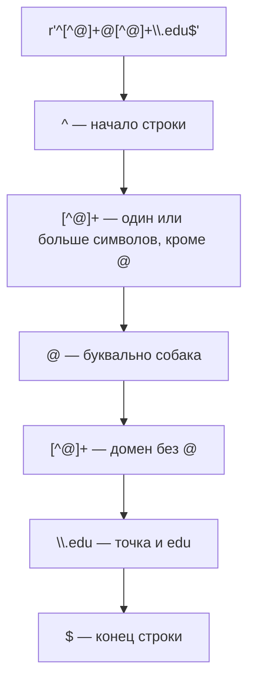

# Неделя 7. Регулярные выражения

> **Лекция:** [YouTube](https://youtu.be/hy3sd9MOAcc) · [видеоплеер](https://video.cs50.io/hy3sd9MOAcc) · [MP3](https://cdn.cs50.net/python/2022/x/lectures/7/lecture7.mp3)
> **Текст:** [notes](https://cs50.harvard.edu/python/notes/7/) · [слайды PDF](https://cdn.cs50.net/python/2022/x/lectures/7/lecture7.pdf) · [код](https://cdn.cs50.net/python/2022/x/lectures/7/src7.zip)
> **Задачи:** [Problem Set 7](https://cs50.harvard.edu/python/psets/7/)
> Shorts: [Patterns](https://cs50.harvard.edu/python/shorts/patterns/) · [Capture Groups](https://cs50.harvard.edu/python/shorts/capture_groups/)
> Назад: [[Курсы/CS50P/README|оглавление]] · Предыдущая: [[Курсы/CS50P/Неделя 6 — Файлы|Неделя 6]]

## Что нужно понять к концу недели

- регулярное выражение — шаблон для поиска и проверки текста;
- `re.search` ищет где угодно, `re.match` — с начала, `re.fullmatch` — всю строку;
- классы `[]`, `\d`, `\w`, `\s` и квантификаторы `*`, `+`, `?`, `{n}`;
- группы `(...)` и `(...)?` достают части совпадения;
- `re.sub` заменяет по шаблону;
- `r"..."` — «сырая» строка, без двойного экранирования.

---

## 1. Зачем

Проверка email вручную превращается в лес условий. Регулярка описывает **формат** одной строкой:

```python
import re

email = input("What's your email? ").strip()

if re.search(r"^[^@]+@[^@]+\.edu$", email):
    print("Valid")
else:
    print("Invalid")
```

`r"..."` — raw string. В обычной строке `\d` надо писать `\\d`, иначе Python попытается съесть `\d`. В регулярках **всегда** ставь `r`.

## 2. Три функции

| Функция | Где ищет | Когда использовать |
|---|---|---|
| `re.search(pattern, s)` | где угодно в строке | «есть ли шаблон» |
| `re.match(pattern, s)` | только с начала | «начинается ли с» |
| `re.fullmatch(pattern, s)` | вся строка целиком | «строка ровно этого формата» |

```python
re.search(r"cat", "a cat here")     # match
re.fullmatch(r"cat", "a cat here")  # None
re.fullmatch(r"cat", "cat")         # match
```

`^` и `$` — якоря начала и конца. В `re.search` они обязательны, если нужна вся строка.

## 3. Классы символов

| Шаблон | Что значит |
|---|---|
| `.` | любой символ, кроме перевода строки |
| `\d` | цифра `[0-9]` |
| `\D` | не цифра |
| `\w` | буква, цифра, `_` |
| `\W` | не `\w` |
| `\s` | пробельный символ |
| `\S` | не пробельный |
| `[abc]` | один из символов `a`, `b`, `c` |
| `[^abc]` | любой, кроме `a`, `b`, `c` |
| `[a-z]` | диапазон |

## 4. Квантификаторы

| Шаблон | Что значит |
|---|---|
| `*` | 0 или больше |
| `+` | 1 или больше |
| `?` | 0 или 1 (необязательный) |
| `{n}` | ровно n |
| `{n,m}` | от n до m |

```python
r"^\d{4}$"        # ровно 4 цифры
r"^[a-z]+$"       # одна или больше строчных букв
r"^colou?r$"      # color или colour
```

Квантификатор относится к **предыдущему** элементу: `ab+` — это `a` и один-или-больше `b`, а не «ab повторяется».

## 5. Группы

```python
import re

url = input("URL: ").strip()
username = re.sub(r"^(https?://)?(www\.)?twitter\.com/", "", url)
print(f"Username: {username}")
```

- `(...)` — группа; `?` после группы делает её необязательной;
- `re.sub(pattern, repl, s)` заменяет все совпадения (или указанное количество);
- `re.search(...).group(1)` — первая группа, `.group(0)` — всё совпадение.

```python
m = re.search(r"^(\w+),\s*(\w+)$", "Malan, David")
if m:
    print(m.group(1))   # Malan
    print(m.group(2))   # David
```

Именованные группы читаются лучше:

```python
m = re.search(r"^(?P<last>\w+),\s*(?P<first>\w+)$", "Malan, David")
print(m.group("first"))   # David
```

## 6. Флаги

```python
re.search(r"^[^@]+@[^@]+\.edu$", email, re.IGNORECASE)
```

| Флаг | Что делает |
|---|---|
| `re.IGNORECASE` (`re.I`) | без учёта регистра |
| `re.MULTILINE` (`re.M`) | `^`/`$` на каждой строке |
| `re.DOTALL` (`re.S`) | `.` включает `\n` |

Без флага `[a-z]` не совпадёт с `A`. Это самая частая причина «регулярка не работает».

## 7. Как читать регулярку



Читай слева направо и проговаривай словами. Если не можешь проговорить — упрости шаблон.

## 8. Практика

Валидация:

```python
r"^\d{3}-\d{3}-\d{4}$"     # 555-123-4567
r"^[A-Z]{2}\d{2}$"         # CS50
```

Извлечение:

```python
m = re.search(r"(\d{1,2}):(\d{2})", "Time: 7:30")
print(m.group(1), m.group(2))   # 7 30
```

Замена:

```python
re.sub(r"\s+", " ", text)          # схлопнуть пробелы
re.sub(r"[^\w\s]", "", text)       # убрать пунктуацию
```

> [!warning] Жадность
> `.*` жадный: захватит максимум возможного. `.*?` — ленивый, минимум. В `r"<.*>"` на строке `<a><b>` совпадением будет `<a><b>`, а не `<a>`.

> [!tip] Проверяй на regex101.com
> Вставь шаблон и тестовые строки, включи Python-режим и смотри подсветку групп. Быстрее, чем 20 запусков скрипта.

## Термины

| Английский | Русский | Смысл |
|---|---|---|
| regular expression | регулярное выражение | шаблон поиска |
| pattern | шаблон | сама регулярка |
| capture group | группа захвата | `(...)`, достаём часть |
| anchor | якорь | `^`, `$` |
| quantifier | квантификатор | `*`, `+`, `?`, `{}` |
| greedy | жадный | захватывает максимум |
| flag | флаг | `IGNORECASE` и др. |

## Задачи недели (перевод условий)

> Точные требования — в [оригинале](https://cs50.harvard.edu/python/psets/7/).

| Задача | Что нужно сделать | Ссылка |
|---|---|---|
| **NUMB3RS** | Проверить, что IPv4-адрес состоит из 4 чисел 0–255 через `re.search` | [numb3rs](https://cs50.harvard.edu/python/psets/7/numb3rs/) |
| **Watch on YouTube** | Из HTML достать `src` у `iframe`, вернуть короткую ссылку `youtu.be/...` | [watch](https://cs50.harvard.edu/python/psets/7/watch/) |
| **Working 9 to 5** | Перевести время `9 AM to 5 PM` в 24-часовой формат; ошибки → `ValueError` | [working](https://cs50.harvard.edu/python/psets/7/working/) |
| **Regular, um, Expressions** | Посчитать, сколько раз встречается `um` как отдельное слово | [um](https://cs50.harvard.edu/python/psets/7/um/) |
| **Response Validation** | Проверить ответы формы: email, номер, дату и т.д. по заданным форматам | [response](https://cs50.harvard.edu/python/psets/7/response/) |

Что пригодится:

- `re.search(r"^\d{1,3}\.\d{1,3}\.\d{1,3}\.\d{1,3}$", ip)`, а диапазон 0–255 проверяй отдельно;
- `re.search(r'src="https?://(?:www\.)?youtube\.com/embed/([^"]+)"', html)`;
- `\bum\b` — границы слова, иначе поймаешь `umbrella`;
- флаг `re.IGNORECASE` для `AM/PM`;
- `re.fullmatch` удобнее, когда строка должна совпасть целиком.

## Чек-лист недели

- [ ] Понимаю разницу `search` / `match` / `fullmatch`
- [ ] Знаю, зачем `r"..."` перед шаблоном
- [ ] Достал группу через `.group(1)`
- [ ] Проверил регистр через `re.IGNORECASE`
- [ ] Все 5 задач сданы
- [ ] Коммит `week7: regex`

Дальше: [[Курсы/CS50P/Неделя 8 — ООП]]
