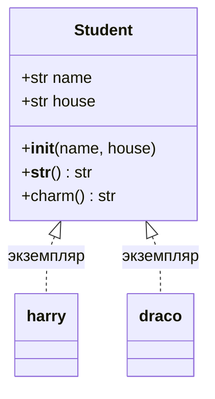
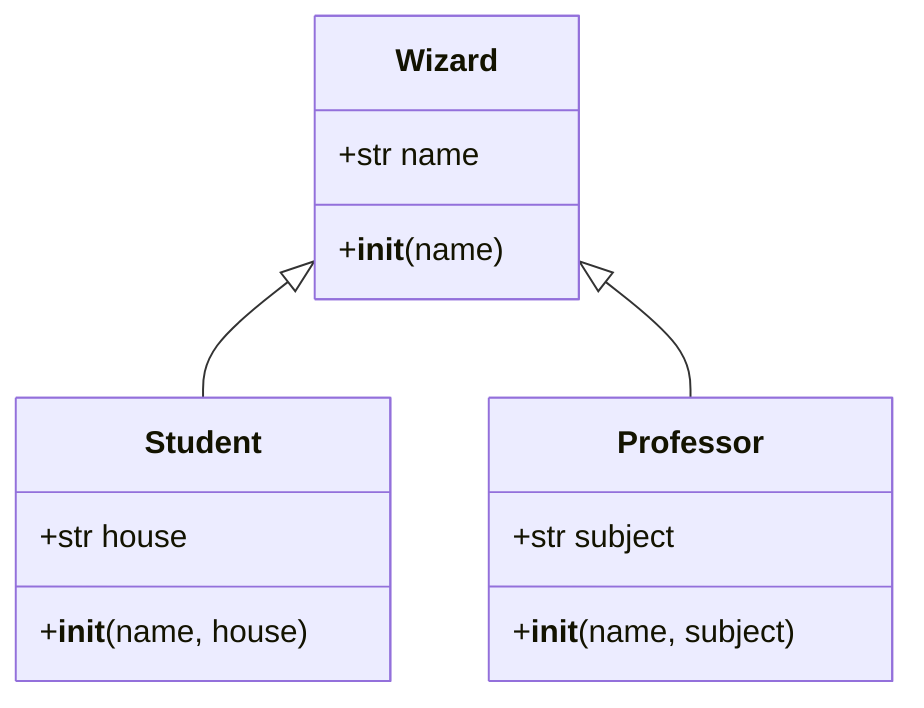

# Неделя 8. ООП: классы и объекты

> **Лекция:** [YouTube](https://youtu.be/e4fwY9ZsxPw) · [видеоплеер](https://video.cs50.io/e4fwY9ZsxPw) · [MP3](https://cdn.cs50.net/python/2022/x/lectures/8/lecture8.mp3)
> **Текст:** [notes](https://cs50.harvard.edu/python/notes/8/) · [слайды PDF](https://cdn.cs50.net/python/2022/x/lectures/8/lecture8.pdf) · [код](https://cdn.cs50.net/python/2022/x/lectures/8/src8.zip)
> **Задачи:** [Problem Set 8](https://cs50.harvard.edu/python/psets/8/)
> Shorts: [Classes](https://cs50.harvard.edu/python/shorts/classes/) · [Instance Variables](https://cs50.harvard.edu/python/shorts/instance_variables/) · [Instance Methods](https://cs50.harvard.edu/python/shorts/instance_methods/) · [Class Methods and Class Variables](https://cs50.harvard.edu/python/shorts/class_methods_class_variables/)
> Назад: [[Курсы/CS50P/README|оглавление]] · Предыдущая: [[Курсы/CS50P/Неделя 7 — Регулярные выражения|Неделя 7]]

## Что нужно понять к концу недели

- класс — чертёж, объект — вещь, сделанная по чертежу;
- `__init__` — конструктор, `self` — сам объект;
- переменные экземпляра принадлежат объекту, переменные класса — всем сразу;
- методы — функции внутри класса, `@property` — управляемый доступ к полю;
- `@classmethod` и `@staticmethod` — методы, которым не нужен конкретный объект;
- наследование позволяет расширить класс, не переписывая его;
- `__str__` и `__eq__` меняют поведение объекта в `print` и `==`.

---

## 1. От словаря к классу

```python
student = {"name": "Harry", "house": "Gryffindor"}
print(student["name"])
```

Словарь не знает, какие поля обязательны, и позволяет опечатку `student["nmae"]`.

```python
class Student:
    def __init__(self, name, house):
        self.name = name
        self.house = house

student = Student("Harry", "Gryffindor")
print(student.name)
```

- `class Student:` — объявление типа;
- `__init__` вызывается при `Student(...)`;
- `self` — ссылка на создаваемый объект; Python передаёт её автоматически;
- `self.name = name` создаёт **переменную экземпляра**.



## 2. Методы

```python
class Student:
    def __init__(self, name, house):
        self.name = name
        self.house = house

    def charm(self):
        match self.house:
            case "Gryffindor":
                return "🦁"
            case "Slytherin":
                return "🐍"
            case _:
                return "🪄"

student = Student("Harry", "Gryffindor")
print(student.charm())
```

Метод — функция, у которой первым параметром идёт `self`. Внутри класса к полям обращаются через `self.`, снаружи — через имя объекта.

`__str__` задаёт, что печатается:

```python
class Student:
    def __init__(self, name, house):
        self.name = name
        self.house = house

    def __str__(self):
        return f"{self.name} from {self.house}"

print(Student("Harry", "Gryffindor"))   # Harry from Gryffindor
```

Без `__str__` в `print` будет что-то вроде `<__main__.Student object at 0x...>`.

## 3. Валидация через property

Поле можно сделать управляемым: проверять значение при установке.

```python
class Student:
    def __init__(self, name, house):
        if not name:
            raise ValueError("Missing name")
        self.name = name
        self.house = house

    @property
    def house(self):
        return self._house

    @house.setter
    def house(self, house):
        if house not in ["Gryffindor", "Hufflepuff", "Ravenclaw", "Slytherin"]:
            raise ValueError("Invalid house")
        self._house = house
```

- `@property` делает метод «полем» для чтения;
- `@house.setter` перехватывает присваивание `student.house = ...`;
- настоящее хранилище — `_house` с подчёркиванием: соглашение «не трогать снаружи».

Теперь `student.house = "Gryffindorrr"` упадёт с `ValueError`, а не создаст молча невалидный объект.

> [!warning] Не обходи защиту
> `student._house = "..."` технически возможно. Подчёркивание — договорённость, а не замок. В Python взрослые не лезут в чужие `_поля`.

## 4. Переменные класса

```python
class Student:
    school = "Harvard"          # одна на весь класс

    def __init__(self, name):
        self.name = name            # своя у каждого

print(Student.school)               # Harvard
```

| Что | Где объявлена | Кому принадлежит |
|---|---|---|
| переменная экземпляра | `self.x = ...` в `__init__` | каждому объекту отдельно |
| переменная класса | прямо в теле класса | всем объектам и классу |

## 5. classmethod и staticmethod

```python
import random

class Hat:
    houses = ["Gryffindor", "Hufflepuff", "Ravenclaw", "Slytherin"]

    @classmethod
    def sort(cls, name):
        print(name, "is in", random.choice(cls.houses))

Hat.sort("Harry")
```

- `@classmethod` получает `cls` — сам класс, а не объект. Нужен, когда объект не требуется;
- `@staticmethod` не получает ни `self`, ни `cls` — просто функция, положенная в класс для порядка.

Не плоди класс ради одного метода: `Hat` оправдан, если вокруг него есть состояние (`houses`) и логика.

## 6. Наследование

```python
class Wizard:
    def __init__(self, name):
        if not name:
            raise ValueError("Missing name")
        self.name = name

class Student(Wizard):
    def __init__(self, name, house):
        super().__init__(name)      # вызвать конструктор родителя
        self.house = house

class Professor(Wizard):
    def __init__(self, name, subject):
        super().__init__(name)
        self.subject = subject
```

`Student` получает всё, что есть у `Wizard`, и добавляет `house`. `super()` вызывает метод родителя — не дублируй проверку имени.



Наследование — это «является»: студент **является** волшебником. Если отношение «имеет» (студент **имеет** сову), это поле, а не наследование.

Исключения тоже классы, поэтому можно наследовать и их:

```python
class InvalidHouseError(ValueError):
    pass
```

Теперь `except ValueError` поймает и твою ошибку — совместимость сохранена.

## 7. Перегрузка операторов

```python
class Point:
    def __init__(self, x, y):
        self.x = x
        self.y = y

    def __eq__(self, other):
        return self.x == other.x and self.y == other.y

    def __str__(self):
        return f"({self.x}, {self.y})"

print(Point(1, 2) == Point(1, 2))   # True
```

`==` по умолчанию сравнивает «тот же объект в памяти». `__eq__` задаёт сравнение по смыслу. Так же работают `__add__`, `__len__`, `__lt__` и другие dunder-методы.

> [!note] Не переусердствуй
> Класс нужен, когда есть данные и поведение, которые ходят вместе. Для «трёх полей и одного расчёта» хватит функции и словаря. ООП — инструмент, а не обряд.

## Термины

| Английский | Русский | Смысл |
|---|---|---|
| class | класс | чертёж объекта |
| instance / object | экземпляр / объект | конкретная вещь |
| method | метод | функция класса |
| attribute | атрибут | поле объекта |
| constructor | конструктор | `__init__` |
| inheritance | наследование | «является» |
| encapsulation | инкапсуляция | скрыть внутренности |
| overloading | перегрузка | своё поведение оператора |

## Задачи недели (перевод условий)

> Точные требования — в [оригинале](https://cs50.harvard.edu/python/psets/8/).

| Задача | Что нужно сделать | Ссылка |
|---|---|---|
| **Seasons of Love** | По дате рождения `YYYY-MM-DD` посчитать минуты жизни и вывести их **прописью по-английски** (как в песне из Rent); неверная дата → `sys.exit` | [seasons](https://cs50.harvard.edu/python/psets/8/seasons/) |
| **Cookie Jar** | Класс `Jar` с ёмкостью: `deposit`, `withdraw`, `capacity`, `size`; нельзя превысить и нельзя уйти в минус | [jar](https://cs50.harvard.edu/python/psets/8/jar/) |
| **CS50 Shirtificate** | Класс `Shirtificate`: белая рубашка с именем поверх, сохранение в PDF | [shirtificate](https://cs50.harvard.edu/python/psets/8/shirtificate/) |

Что пригодится:

- `datetime.date.fromisoformat("2024-03-01")` и `date.today()`;
- разница дат: `(today - birth).days * 24 * 60`;
- `raise ValueError("...")` в `withdraw`, если сумма больше остатка;
- `fpdf2`: `PDF()`, `add_page()`, `image()`, `set_font()`, `cell()`, `output()`;
- `@property` для `capacity` и `size` — задание требует именно их.

## Чек-лист недели

- [ ] Объясню, что такое `self` и почему он первый
- [ ] Сделал класс с `__init__`, методом и `__str__`
- [ ] Понимаю, зачем `_house` и `@property`
- [ ] Отличию `@classmethod` от `@staticmethod` на примере
- [ ] Написал `Student(Wizard)` с `super().__init__`
- [ ] Все 3 задачи сданы
- [ ] Коммит `week8: oop`

Дальше: [[Курсы/CS50P/Неделя 9 — И прочее]]
