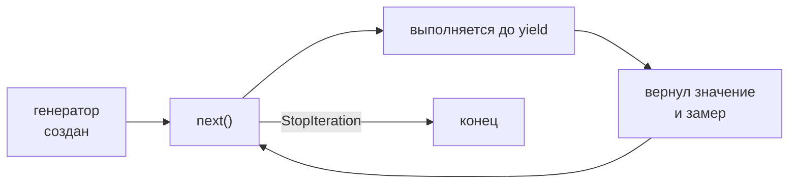

# Неделя 9. И прочее (Et Cetera)

> **Лекция:** [YouTube](https://youtu.be/6pgodt1mezg) · [видеоплеер](https://video.cs50.io/6pgodt1mezg) · [MP3](https://cdn.cs50.net/python/2022/x/lectures/9/lecture9.mp3)
> **Текст:** [notes](https://cs50.harvard.edu/python/notes/9/) · [слайды PDF](https://cdn.cs50.net/python/2022/x/lectures/9/lecture9.pdf) · [код](https://cdn.cs50.net/python/2022/x/lectures/9/src9.zip)
> Shorts: [Recursion](https://cs50.harvard.edu/python/shorts/recursion/)
> Назад: [[Курсы/CS50P/README|оглавление]] · Предыдущая: [[Курсы/CS50P/Неделя 8 — ООП|Неделя 8]]

## Что нужно понять к концу недели

- `set` — коллекция без повторов и без порядка;
- `global` нужно объявлять, чтобы менять глобальную переменную внутри функции (и лучше так не делать);
- константы пишут ЗАГЛАВНЫМИ;
- аннотации типов и docstrings документируют код, но не проверяют его;
- `argparse` — нормальный разбор аргументов командной строки;
- `*args`, `**kwargs`, распаковка `*` и `**`;
- comprehensions, `map`, `filter`, `enumerate` заменяют длинные циклы;
- генераторы (`yield`) выдают значения по одному и не держат всё в памяти.

---

## 1. set

```python
students = [
    {"name": "Harry", "house": "Gryffindor"},
    {"name": "Draco", "house": "Slytherin"},
    {"name": "Ron", "house": "Gryffindor"},
]

houses = set()
for student in students:
    houses.add(student["house"])

for house in sorted(houses):
    print(house)
```

`set` хранит **уникальные** значения. Повторное `add` ничего не делает.

| Операция | Запись |
|---|---|
| объединение | `a \| b` |
| пересечение | `a & b` |
| разность | `a - b` |
| проверка | `x in a` — очень быстро |

У `set` нет индексов: порядок не определён. Нужен порядок — `sorted(set)` → список.

## 2. global

```python
balance = 0

def main():
    print("Balance:", balance)
    deposit(100)
    withdraw(50)
    print("Balance:", balance)

def deposit(n):
    global balance
    balance += n

def withdraw(n):
    global balance
    balance -= n
```

Без `global` строка `balance += n` создаст **локальную** переменную и упадёт с `UnboundLocalError`.

`global` работает, но делает программу хрупкой: любая функция может незаметно поменять состояние. Лучше передавать значение и возвращать новое, или хранить состояние в объекте (неделя 8).

## 3. Константы

```python
MEOWS = 3

for _ in range(MEOWS):
    print("meow")
```

В Python нет `const`. Соглашение: имя ЗАГЛАВНЫМИ = «не менять». Это сигнал читателю, а не запрет для интерпретатора.

## 4. Аннотации типов

```python
def meow(n: int) -> str:
    return "meow\n" * n

number: int = int(input("Number: "))
meows: str = meow(number)
print(meows, end="")
```

- `n: int` — подсказка, что ждём целое;
- `-> str` — что вернём;
- Python **не проверяет** это во время выполнения: `meow("3")` не упадёт на аннотации.

Проверять типы статически умеет `mypy`:

```bash
mypy program.py
```

В больших проектах аннотации экономят часы: редактор подсказывает поля и ловит несовместимости до запуска.

## 5. Docstrings

```python
def meow(n: int) -> str:
    """Мяукнуть n раз.

    Args:
        n: сколько раз мяукнуть.

    Returns:
        Строка с n строками "meow".
    """
    return "meow\n" * n
```

Тройные кавычки сразу под `def` — документация функции. Её видно в `help(meow)` и во всплывающих подсказках VS Code. Комментарий `#` объясняет реализацию, docstring — **что функция делает** для пользователя.

## 6. argparse

Ручной разбор `sys.argv` быстро становится лесом проверок. `argparse` делает это за тебя:

```python
import argparse

parser = argparse.ArgumentParser(description="Meow like a cat")
parser.add_argument("-n", type=int, default=1, help="number of meows")
args = parser.parse_args()

for _ in range(args.n):
    print("meow")
```

```bash
python meow.py -n 3
python meow.py --help
```

`argparse` сам:

- проверяет, что `-n` — целое (`type=int`);
- подставляет `default`;
- печатает `--help`;
- ругается на неизвестные аргументы и выходит с кодом 2.

Это стандарт для CLI-утилит. В финальном проекте он пригодится.

## 7. Распаковка

```python
first, second, third = ["a", "b", "c"]
first, *rest = [1, 2, 3, 4]      # first=1, rest=[2, 3, 4]
```

```python
def total(*values):
    return sum(values)

print(total(1, 2, 3))            # 6 — values = (1, 2, 3)
```

```python
def tags(**kwargs):
    for key, value in kwargs.items():
        print(key, "=", value)

tags(lang="python", level=1)
```

| Запись | Смысл |
|---|---|
| `*args` | любое число позиционных → кортеж |
| `**kwargs` | любое число именованных → словарь |
| `f(*args)` | распаковать список в аргументы |
| `f(**kwargs)` | распаковать словарь в именованные |

## 8. map, filter, comprehensions

```python
words = ["apple", "banana"]

upper = list(map(str.upper, words))          # ['APPLE', 'BANANA']
long_ones = list(filter(lambda w: len(w) > 5, words))
```

То же самое читается comprehension:

```python
upper = [w.upper() for w in words]
long_ones = [w for w in words if len(w) > 5]
squares = [x * x for x in range(5)]          # [0, 1, 4, 9, 16]
```

Словарь:

```python
houses = {s["name"]: s["house"] for s in students}
```

Множество:

```python
houses = {s["house"] for s in students}
```

Правило: comprehension хорош, пока в нём **одно** условие и **одно** преобразование. Вложенные трёхуровневые конструкции — зло; пиши обычный цикл.

## 9. enumerate

```python
names = ["Harry", "Ron", "Hermione"]

for i, name in enumerate(names, start=1):
    print(i, name)
```

`enumerate` даёт пару «индекс, значение» и избавляет от `range(len(...))`.

## 10. Генераторы и итераторы

```python
def main():
    for i in sheep():
        print(i)

def sheep():
    yield "baa"
    yield "baa"
    yield "baa"
```

Функция с `yield` не выполняется сразу — она возвращает **генератор**. Значения выдаются по одному при каждом `next()`.

```python
def count_up(n):
    i = 0
    while i < n:
        yield i
        i += 1

for x in count_up(3):
    print(x)     # 0 1 2
```



Зачем:

- память: `count_up(10**9)` не строит список на миллиард элементов;
- бесконечные последовательности;
- конвейеры: `(x * 2 for x in data)` — ленивое преобразование.

Итератор — объект с `__next__`, который помнит позицию. Генератор — самый простой способ его сделать. `for` работает с любым итератором.

> [!note] Рекурсия
> Shorts [Recursion](https://cs50.harvard.edu/python/shorts/recursion/) — про функцию, вызывающую себя. В CS50P рекурсия не обязательна, но понимать её нужно: она будет в CS50x (сортировки, деревья).

## Термины

| Английский | Русский | Смысл |
|---|---|---|
| set | множество | уникальные элементы |
| global | глобальная переменная | видна во всём модуле |
| constant | константа | по соглашению ЗАГЛАВНЫМИ |
| type hint | аннотация типа | `n: int`, `-> str` |
| docstring | строка документации | описание функции |
| comprehension | включение | короткая запись цикла |
| generator | генератор | ленивая выдача значений |
| iterator | итератор | объект с `__next__` |
| yield | «выдать» | пауза генератора |

## Мини-задания недели

Официального Problem Set 9 нет. Чтобы закрепить:

| Задание | Что сделать |
|---|---|
| CLI-утилита | `argparse` + чтение файла + вывод статистики. Аргументы: путь, `--top N`, `--json` |
| Comprehension-разминка | Переписать три своих старых цикла через list/dict comprehension |
| Генератор | `fib()` — бесконечные числа Фибоначчи через `yield`, взять первые 15 через `islice` |
| Типы | Добавить аннотации и docstrings в `project.py` будущего финального проекта |

## Чек-лист недели

- [ ] Понимаю, почему `set` быстрее списка в проверке `in`
- [ ] Знаю, когда нужен `global` и почему его избегают
- [ ] Добавил `type hints` и проверил `mypy`
- [ ] Написал CLI на `argparse` с `--help`
- [ ] Отличаю `*args` от `**kwargs`
- [ ] Написал генератор с `yield`
- [ ] Коммит `week9: et cetera`

Дальше: [[Курсы/CS50P/Финальный проект]]
