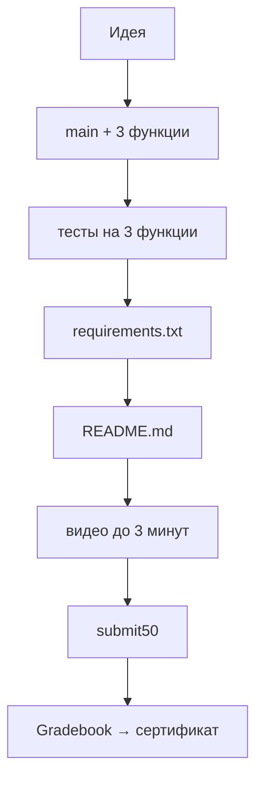

# Финальный проект CS50P

> **Оригинал:** [cs50.harvard.edu/python/project](https://cs50.harvard.edu/python/project/)
> **Галерея чужих проектов:** [cs50.harvard.edu/python/gallery](https://cs50.harvard.edu/python/gallery/)
> **Сдавать:** `submit50 cs50/problems/2022/python/project` из папки проекта
> Назад: [[Курсы/CS50P/README|оглавление]] · Предыдущая: [[Курсы/CS50P/Неделя 9 — И прочее|Неделя 9]]

## Что это

Своя программа на Python, которую ты придумываешь сам. Это не «ещё одна задача по теме»: проект должен занять **больше времени, чем любая задача курса**, и показать, что ты умеешь собрать программу целиком.

## Обязательные требования

| Требование | Детали |
|---|---|
| Язык | только Python |
| `project.py` | в корне проекта, содержит `main` и **минимум 3 свои функции** на том же уровне вложенности, что `main` |
| Тесты | минимум 3 из этих функций покрыты тестами в `test_project.py` в корне; имена — `test_<имя_функции>` |
| Запуск тестов | `pytest` проходит без ошибок |
| Зависимости | всё, что ставится через pip, перечислено в `requirements.txt`, по одной строке |
| `README.md` | название, ссылка на видео, описание проекта на несколько абзацев (~500 слов) |
| Видео | до 3 минут: титул (название, имя, edX/GitHub, город и страна, дата записи), затем демонстрация |
| Честность | код твой; colaboration разрешена, но тогда и объём работы больше |

Видео выкладывается на YouTube (можно unlisted, **не** private) — ссылка идёт в `README.md`.

## Структура

```
project/
├── project.py          # main + 3 функции минимум
├── test_project.py     # тесты для трёх функций
├── requirements.txt    # например: requests, rich
├── README.md           # описание + ссылка на видео
└── data/               # всё, что нужно программе (по желанию)
```

```python
# project.py
def main():
    ...

def function_1():
    ...

def function_2():
    ...

def function_3():
    ...

if __name__ == "__main__":
    main()
```

```python
# test_project.py
from project import function_1, function_2, function_3

def test_function_1():
    assert function_1(...) == ...

def test_function_2():
    ...

def test_function_3():
    ...
```



## Как выбрать идею

Хороший проект для CS50P:

- решает **твою** задачу (не «TODO-лист из туториала»);
- использует 3–4 темы курса: файлы/CSV, API, regex, классы, CLI;
- имеет понятные чистые функции — их легко тестировать;
- демонстрируется за 2 минуты;
- не требует сервера, базы и фронтенда.

Плохой проект: «мессенджер», «соцсеть», «игра на pygame на 5 тысяч строк». Не хватит времени, тесты станут формальностью, видео — оправданием.

### Идеи под твой маршрут (кибербез × ИИ)

| Идея | Что делает | Темы курса |
|---|---|---|
| **Анализатор паролей** | Проверяет длину, энтропию, наличие в утечках (API), генерирует безопасный пароль | regex, `secrets`, API, CLI, классы |
| **Сканер подозрительных ссылок** | Разбирает URL, ищет punycode/фишинг-признаки, проверяет домен по API | regex, `urllib.parse`, requests |
| **Лог-парсер** | Читает access.log, считает топ IP, ошибки, подозрительные пути | файлы, CSV, `Counter`, regex |
| **Трекер привычек** | CLI: отметки в JSON/SQLite, статистика, streak | файлы, даты, argparse |
| **Генератор отчётов по CSV** | Из сырых данных делает markdown/PDF отчёт | CSV, Pillow/fpdf, ООП |

Свои идеи проектов уже разобраны в [[Проекты/Идеи простыми словами]] — можно взять оттуда маленький кусок как проект CS50P, а большой оставить на лето 2027.

## План на 2 недели

| День | Что сделать |
|---|---|
| 1 | Выбрать идею, написать 5 строк «что делает», список функций |
| 2 | Скелет: `main`, три функции-заглушки с `...`, запуск без ошибок |
| 3–5 | Реализовать функции по одной, после каждой — тест |
| 6 | CLI/ввод-вывод: `argparse`, обработка ошибок |
| 7 | `requirements.txt`, `pytest`, `style50`, `mypy` по желанию |
| 8–9 | README на 500 слов: что, зачем, как запустить, какие решения и почему |
| 10 | Записать видео: титул + демонстрация + что бы улучшил |
| 11 | `submit50`, проверить Gradebook |

## README: шаблон

```markdown
# Название проекта
#### Video Demo: <URL>
#### Description:

Что делает программа и какую задачу решает.

Как запустить: зависимости, команда, пример ввода.

Что лежит в файлах: project.py, test_project.py, data/.

Какие решения приняты и почему: например, почему JSON, а не SQLite;
почему regex, а не ручной разбор.

Что бы улучшил, если было бы больше времени.
```

## Сдача и сертификат

1. Из папки проекта: `submit50 cs50/problems/2022/python/project`
2. Через несколько минут открыть [cs50.me/cs50p](https://cs50.me/cs50p) — Gradebook.
3. Именно загрузка Gradebook запускает проверку завершения курса и генерацию бесплатного CS50 Certificate (и Verified Certificate от edX, если все задания сданы).

> [!warning] Проверь до сдачи
> - `pytest` зелёный;
> - `python project.py` работает без трейсбека;
> - файлы лежат в корне, а не во вложенной папке;
> - видео доступно по ссылке в режиме unlisted;
> - в `requirements.txt` нет лишнего и нет пропущенного;
> - README объясняет **почему**, а не только **что**.

## Чек-лист

- [ ] Идея сформулирована одной фразой
- [ ] `main` + 3 функции, все на верхнем уровне
- [ ] 3 теста, `pytest` проходит
- [ ] `requirements.txt` актуален
- [ ] README ~500 слов со ссылкой на видео
- [ ] Видео до 3 минут с титульным экраном
- [ ] `submit50` выполнен, Gradebook открыт
- [ ] Проект добавлен в портфолио на GitHub

Поздравляю: после этого CS50P закрыт. Дальше — [[Курсы/CS50P/README|CS50x]] или специализация из [[plan/README|плана]].
